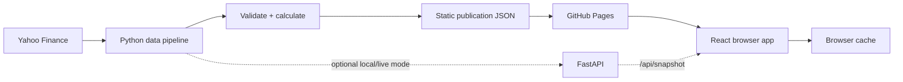

# US Momentum Terminal

[Live site](https://andyttc05.github.io/us-momentum-terminal/) ·
[Repository](https://github.com/andyttc05/us-momentum-terminal)

US Momentum Terminal is an academic research dashboard for a US equity momentum strategy. It ranks a
curated universe by risk-adjusted 12–1 momentum, builds a constrained model portfolio and compares a
historical implementation with SPY and SPMO.

The application does not execute orders and is not investment advice.


## Features

- Overview of market breadth, strategy performance, leading stocks and sector allocation.
- Searchable Screener with Top 100 and Top 20 dataset views, filters, sorting, pagination, and CSV or
  Excel export of the full matching result set.
- Stock Analysis with price history, momentum metrics and month-end rank history.
- Model portfolios with 100 or exactly 20 holdings, float-adjusted weights, stock and sector
  constraints, and CSV or multi-sheet Excel export.
- Backtesting with configurable dates, capital, cashflows, dividends, inflation, rebalancing,
  chart window, log scale, and CSV or multi-sheet Excel results.
- Freshness, browser-cache and fallback states, including a Data & Cache status panel.
- Responsive desktop, tablet and mobile layouts.

## Loading and failure behaviour

The page shell is rendered before market data arrives. Page headers, filters, KPI cards, chart cards,
table headers and pagination remain mounted while their data-dependent contents use shared loading
placeholders. The Screener therefore keeps its scope selector, search, filters, export control,
column headings and pagination throughout the initial request.

Section state is resolved independently:

- loading starts inside the existing component;
- valid cached data remains visible during background refreshes and after a failed update;
- settled failures become explicit error states instead of indefinite loading;
- empty responses show empty states rather than zero values or mock data.

Transient updates use the shared black notification card. A failed refresh never replaces valid
displayed data, and a retry cannot create a second completion notice.

## Architecture



GitHub Pages is static hosting. The production site therefore reads a validated publication from
`frontend/public/data/`; it does not depend on a sleeping Python instance.

A scheduled GitHub Actions workflow runs after the US market close on weekdays. It reuses the Python
provider, validation, momentum, portfolio and backtest code, writes a new static snapshot, and deploys
the resulting Pages artifact. A failed refresh preserves the previous valid snapshot.

The FastAPI service remains available for local development, provider diagnostics and an optional
live-data deployment.

## Technology

| Layer | Technology |
| --- | --- |
| Frontend | React 19, Vite 6, plain CSS, Phosphor Icons |
| Local/live API | Python 3.11+, FastAPI, Uvicorn |
| Data processing | pandas, NumPy, exchange-calendars, yfinance |
| Data publication | Compact JSON, atomic staging, GitHub Actions |
| Hosting | GitHub Pages |
| Tests | Python `unittest`, Node test runner, browser checks |

## Data Pipeline

The static exporter:

1. Reuses the current publication cache or fetches a new validated snapshot.
2. Verifies provider connection, universe coverage, portfolio availability and both backtests.
3. Builds the on-demand Stock Analysis detail payloads from the same bars.
4. Writes compact `publication.json`, `manifest.json` and `stocks/*.json` files.
5. Replaces the existing publication only after all files pass validation.

If a provider or validation step fails, the previous static publication is retained. The UI shows its
actual market date, collection timestamp, provider and cache origin. A browser copy is also kept for
an immediate next visit and for offline-style fallback after a failed request.

### Universe datasets

The publication carries two self-contained datasets, `datasets.top100` and `datasets.top20`. Each one
holds the universe's selected tickers in rank order, its model portfolio and its own Overview block
(holding count, Top Momentum, sector allocation and strategy performance). A dataset also carries its
provenance: universe, target holdings, calculation date, data timestamp, run identifier and success
status.

The app keeps three states apart:

| State | Storage | Meaning |
| --- | --- | --- |
| Selected universe | `umt:universe:v1` | The universe configured for the next Backtest run |
| Completed backtest universe | component state | The universe of the most recent successful run |
| Active dataset universe | `umt:active-universe:v1` | The dataset Overview, Screener and Portfolio display |

Editing the Backtesting Universe control changes only the selection: it never relabels results that were
already computed. A successful run promotes its own universe to the active dataset, so all three
dependent pages switch together. Choosing a dataset from the Screener toolbar activates it app-wide and
keeps the selection in step.

Every page reads one dataset, so a Top 20 view can never pair 20 holdings with Top 100 momentum rows,
sector weights or export rows. Holding counts, target-holding constraints, pagination totals and
exports all derive from the active dataset.

### Sources and freshness

The default source is Yahoo Finance through the unofficial `yfinance` client. It supplies daily
OHLCV, adjusted closes, dividends, splits and current quote/fundamental metadata. Optional Twelve
Data and FMP adapters require private server-side keys. Stooq is retained as an adapter but is not used
because its anonymous download is blocked and it does not provide adjusted closes.

The browser never calls a market-data provider and never receives API keys. GitHub Actions publishes
only the validated application payload. Provider-derived data remains subject to the provider's
terms; see [THIRD_PARTY_NOTICES.md](THIRD_PARTY_NOTICES.md).

The latest successful collection and market date are recorded in:

- `frontend/public/data/manifest.json`
- `frontend/public/data/publication.json` → `meta.generated_at`, `meta.as_of`
- the in-app **Data & Cache** panel opened from the update pill

## Local Development

Requirements: Python 3.11+, Node.js 20+, npm and internet access.

```bash
npm run data:install
npm --prefix frontend ci
```

Run the local live-data stack:

```bash
npm run data:serve
npm run dev
```

Open `http://127.0.0.1:5173`. Vite proxies `/api` to the FastAPI service on port `8787`.

To run the frontend against the committed static publication instead:

```bash
VITE_DATA_MODE=static npm --prefix frontend run dev
```

To refresh and validate the committed static publication manually:

```bash
npm run data:build-static
npm run data:validate-static
```

Optional provider keys belong only in a local, git-ignored `.env`. Copy `.env.example` when needed.

## Tests

```bash
npm run data:test
npm run test:frontend
npm run test:sites
npm run build
```

Provider availability is tested with real network requests:

```bash
npm run data:probe
```

The probe writes `data-service/docs/provider_probe.json`. It does not synthesize successful results.

## Deployment

`.github/workflows/deploy-pages.yml` deploys on:

- every push to `main`;
- a weekday schedule at `22:23 UTC`, after the regular US close;
- manual `workflow_dispatch`.

Pushes validate and deploy the committed static snapshot. Scheduled/manual runs refresh the snapshot
before building. The workflow requires no provider secrets for the default Yahoo path.

The Pages build uses:

```text
VITE_BASE_PATH=/us-momentum-terminal/
VITE_DATA_MODE=static
VITE_BACKTEST_API_BASE_URL=https://us-momentum-data.onrender.com/api
```

The initial snapshot includes the default semiannual backtest. Other rebalancing schedules are
served as separate same-origin JSON files for the published date range. A user-selected date range
outside that publication uses the configured quantitative backtest endpoint, while all dashboard
data remains static.

## Project Structure

```text
.
├── .github/workflows/       CI and scheduled Pages deployment
├── data-service/
│   ├── app/                 Providers, validation, analytics and FastAPI
│   ├── docs/                Provider evidence and generated reports
│   ├── scripts/             Static publication exporter
│   ├── seed/                Last repository seed used by the service
│   └── tests/               Unit and live verification tools
├── docs/
│   ├── DATA_PIPELINE.md     Publication, cache and deployment details
│   ├── TECHNICAL_DOCUMENTATION.md
│   └── screenshots/         Curated application screenshots
├── frontend/
│   ├── public/data/         Published JSON snapshot used by GitHub Pages
│   ├── src/                 Pages, components, API cache and styles
│   ├── tests/               Frontend and deployment tests
│   └── worker/              Optional Sites SPA fallback worker
└── package.json
```

## Methodology and Limitations

Momentum uses adjusted closes and a 12–1 window. Scoring combines risk-adjusted momentum with a
cross-sectional Z-score. The model portfolio uses float-adjusted market capitalization multiplied by
Momentum Score, then applies a 9% stock cap and a 35% sector-group cap.

Backtesting's Universe control is the selection for the next run; Overview, Screener and Portfolio read
the active dataset described above. Top 100 and Top 20 mean exactly 100 and exactly 20 ranked eligible
stocks. The model portfolio is rebuilt from the selected candidate universe for each count, with the
same raw weight (`float-adjusted market cap × Momentum Score`), the same 9% stock and 35% sector caps
and the same redistribution solver, so a Top 20 book is never a filtered copy of the Top 100 one.

Temporary state — a universe mismatch, an outdated backtest, a missing price history, an export result —
is reported through the single black notification card in the bottom-right corner. Important errors
stay until dismissed and offer Retry. The persistent data-freshness pill in the page header is not a
notification and is unaffected.

The backtest is a research proxy:

- Top 100 and Top 20 use exact-ranked counts on every signal date;
- changing Universe and not rerunning marks existing results as belonging to the other universe;
- current constituents introduce survivorship and selection bias;
- historical point-in-time float capitalisation is unavailable;
- current fundamentals are applied to historical portfolio construction;
- no delisting-return model, taxes, market impact or capacity limit is included;
- Yahoo Finance is unofficial and has no service-level guarantee or published quota;
- the free site publishes end-of-day snapshots, not a tick-by-tick trading feed.

See [TECHNICAL_DOCUMENTATION.md](docs/TECHNICAL_DOCUMENTATION.md) and
[DATA_PIPELINE.md](docs/DATA_PIPELINE.md) for implementation details.

## License

Project code and original documentation are MIT licensed. Third-party libraries and market data
retain their own terms.
