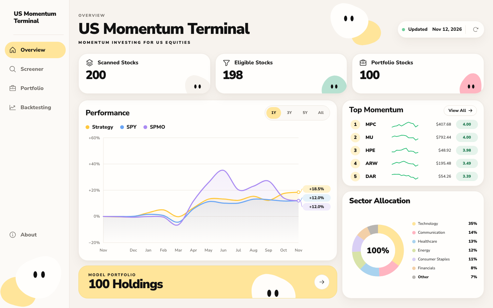
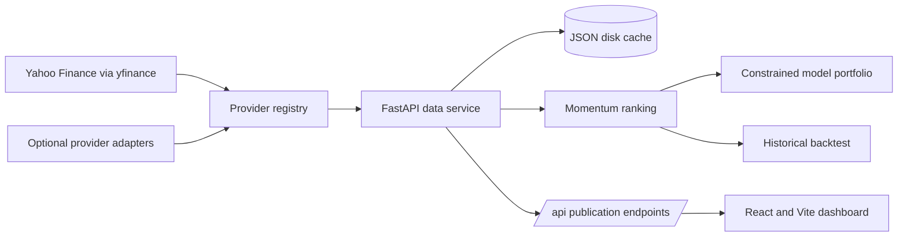

# US Momentum Terminal

[Live website](https://andyttc05.github.io/us-momentum-terminal/) ·
[GitHub repository](https://github.com/andyttc05/us-momentum-terminal)

US Momentum Terminal is an academic research application for studying a US equity momentum strategy.
It combines a React dashboard with a Python market-data service that retrieves prices, calculates
risk-adjusted momentum, ranks stocks, builds a constrained model portfolio, and runs a historical
simulation against SPY and SPMO.

The project is intended for coursework, technical review, and further research. It is not a live
trading system, does not execute orders, and does not provide investment advice.



## Live Demo

The public frontend is deployed with GitHub Pages:

<https://andyttc05.github.io/us-momentum-terminal/>

It connects to the FastAPI data service hosted on Render:

<https://us-momentum-data.onrender.com/api/health>

The free Render service may need time to wake after inactivity. The interface distinguishes fresh,
cached, partial, warming, and unavailable data; it does not substitute placeholder market values.

## Main Features

- Screens a curated 200-symbol US common-stock universe.
- Calculates 12–1 momentum, daily volatility, risk-adjusted momentum, Z-scores, and Momentum Scores.
- Ranks eligible stocks and supports Top 100 and Top 20% views.
- Constructs a 100-stock model portfolio with a 9% stock cap and a 35% sector-group cap.
- Shows overview, screener, portfolio, backtesting, and stock-analysis views.
- Exports screener and complete-portfolio data to CSV.
- Displays data source, market date, cache state, timeliness, and provider health.

## System Architecture



The browser reads one publication payload from the data service. Provider calls and API keys remain
on the Python backend.

## Data Collection

The default provider chain is Yahoo Finance through the unofficial `yfinance` client, followed by
Twelve Data and Financial Modeling Prep when their optional API keys are configured. Stooq exists
as an optional adapter but is excluded from the default scoring chain because it does not supply
adjusted closes and is commonly blocked by an anti-bot challenge.

The live universe is a curated list of 200 unique symbols: a 108-stock audited core plus 92
sector-balanced selections from a larger S&P MidCap 400 candidate pool. It is not a scan of every
US-listed stock.

For each symbol, the service retrieves daily OHLCV history, adjusted closes, and available dividends
and split actions. It also retrieves current quote metadata, including company name, sector,
exchange, currency, security type, market capitalization, shares outstanding, float shares, and
three-month average volume. Records are normalized, duplicate dates are removed, invalid prices are
rejected, and provenance is retained.

## Momentum Strategy

The calculation uses adjusted closing prices and trading-session windows:

```text
12–1 momentum = P(t − 21) / P(t − 252) − 1
daily volatility = sample standard deviation of 252 trailing daily returns
risk-adjusted momentum = decimal 12–1 momentum / daily volatility
Z = (risk-adjusted momentum − cross-sectional mean) / population standard deviation
Z = clip(Z, −3, +3)

Momentum Score = 1 + Z          when Z > 0
Momentum Score = 1 / (1 − Z)   when Z < 0
Momentum Score = 1              when Z = 0
```

Universe eligibility requires a provider-verified common stock, USD currency, listing on NYSE,
NASDAQ, or NYSE American, a latest close of at least $5, at least 210 daily observations, a common
latest observation date, and at least $2 million average daily dollar volume over 63 sessions.
Scoring requires the full 253 observations needed for the 12–1 window.

## Portfolio Construction

The current model selects the top 100 momentum-eligible stocks with verified current float shares.
Each initial weight is proportional to:

```text
float-adjusted market capitalization × Momentum Score
```

A capped proportional solver redistributes the preliminary weights until they total 100% while
respecting the individual-stock and sector-group limits. If the constraints are infeasible, the
service reports that state instead of returning invalid weights.

The official portfolio rebalance is semiannual in March and September. Daily ranking updates do not
automatically create trades.

## Backtesting Method

The historical test is a research proxy for the ranking method:

- Signals form at the last March or September trading session.
- Execution occurs at the next available adjusted close.
- Holdings are marked to market daily.
- Historical books are equal-weighted.
- Transaction costs are 0.10% of traded notional; assumed slippage is 0.00%.
- SPY and SPMO are benchmark series over the same dates.
- Sharpe Ratio uses a documented 0% risk-free rate.

The backtest uses the audited 108-symbol historical core rather than applying today's 92 additions
retrospectively. It is not a point-in-time reconstruction: current constituents and current
fundamentals introduce survivorship, selection, and look-ahead limitations. Historical
float-adjusted market capitalization is unavailable, which is why the backtest uses equal weights.

## Technology Stack

| Layer | Technology |
| --- | --- |
| Frontend | React 19, Vite 6, plain CSS, Phosphor Icons |
| Backend | Python 3.11+, FastAPI, Uvicorn |
| Quant processing | pandas, NumPy, `exchange-calendars` |
| Market data | `yfinance` primary; optional Twelve Data and FMP adapters |
| Persistence | Atomic JSON disk cache and verified publication seed |
| Testing | Python `unittest`, Node test runner, live API verification |
| Deployment | GitHub Pages frontend, Render FastAPI backend |

## Project Structure

```text
.
├── .github/workflows/       # CI and GitHub Pages deployment
├── data-service/
│   ├── app/                 # FastAPI, providers and quantitative engines
│   ├── docs/                # Provider report and generated evidence
│   ├── seed/                # Verified publication seed
│   └── tests/               # Unit and live integration checks
├── docs/
│   ├── screenshots/         # Curated application screenshots
│   ├── PROJECT_OVERVIEW.md
│   ├── TECHNICAL_DOCUMENTATION.md
│   ├── DATA_AUDIT_REPORT.md
│   ├── STRATEGY_VALIDATION_REPORT.md
│   └── FINAL_VALIDATION_REPORT.md
├── frontend/
│   ├── src/                 # React pages, components, styles and API client
│   ├── tests/               # Frontend and Sites tests
│   └── worker/              # Sites fallback worker
├── .env.example
├── LICENSE
├── THIRD_PARTY_NOTICES.md
├── package.json
└── package-lock.json
```

## Local Installation

Requirements: Python 3.11+, Node.js 20+, npm, and internet access.

```bash
npm run data:install
npm --prefix frontend ci
```

Optional backup provider keys can be added by copying `.env.example` to `.env`. Never commit `.env`.

Start the backend and frontend in separate terminals:

```bash
npm run data:serve
npm run dev
```

The frontend runs at `http://127.0.0.1:5173/`; the API runs at `http://127.0.0.1:8787/`.

Run the production build and checks with:

```bash
npm run data:test
npm run build
npm --prefix frontend run test:unit
npm run test:sites
```

With the data service running, `npm run data:verify` checks the live API, calculations, portfolio
constraints, and backtest timing.

## Limitations

- The universe is curated rather than a complete US exchange master.
- Yahoo Finance is an unofficial provider without a service-level agreement.
- Market capitalization and float shares are current, not point-in-time historical observations.
- The historical universe omits a complete set of delisted securities and stable ticker identities.
- The backtest is equal-weighted rather than float-cap weighted.
- The Sharpe Ratio assumes a 0% risk-free rate.
- No taxes, market impact, capacity constraints, order execution, or paper-trading record are modeled.
- Past performance does not establish future returns or investment suitability.

## Documentation

- [Academic Project Overview](docs/PROJECT_OVERVIEW.md)
- [Technical Documentation](docs/TECHNICAL_DOCUMENTATION.md)
- [Data Audit Report](docs/DATA_AUDIT_REPORT.md)
- [Strategy Validation Report](docs/STRATEGY_VALIDATION_REPORT.md)
- [Final Validation Report](docs/FINAL_VALIDATION_REPORT.md)
- [Data Provider Report](data-service/docs/DATA_PROVIDERS.md)

## License

Original project code and documentation are distributed under the [MIT License](LICENSE). Third-party
libraries, fonts, icons, market data, and other third-party material remain subject to their own
terms. See [THIRD_PARTY_NOTICES.md](THIRD_PARTY_NOTICES.md).
