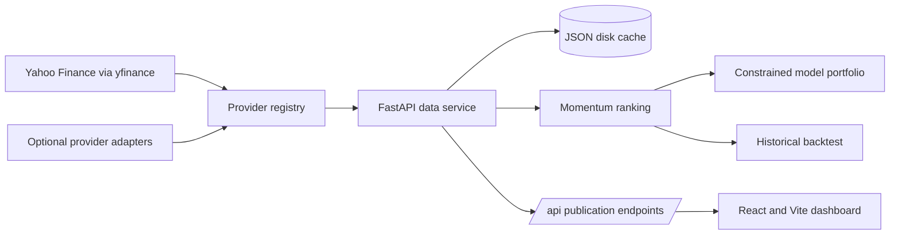

# US Momentum Terminal

[Live website](https://andyttc05.github.io/us-momentum-terminal/) ·
[GitHub repository](https://github.com/andyttc05/us-momentum-terminal)

An academic research application for studying a US equity momentum strategy. A React dashboard sits
on top of a Python market-data service that retrieves prices, calculates risk-adjusted momentum,
ranks stocks, constructs a constrained model portfolio, and runs a historical simulation against
SPY and SPMO.

The project is coursework and technical reference material. It is not a trading system, it does not
execute orders, and nothing in it is investment advice.


## 1. Project Overview

The terminal answers one question end to end: given adjusted US equity prices, which stocks carry
the strongest risk-adjusted 12–1 momentum right now, and what would a disciplined portfolio built
from that ranking have returned historically?

| Screen | Question it answers |
| --- | --- |
| Overview | How has the strategy performed, and what is leading today? |
| Screener | Which stocks rank highest, and how did each one get there? |
| Stock Analysis | What is this symbol's price history, momentum and rank history? |
| Portfolio | How is the model book allocated, by stock and by sector? |
| Backtesting | How did the ranking behave across a chosen window, against SPY and SPMO? |

The Python service builds the historical return paths, rankings and publication data. The frontend
formats, sorts and plots those paths, and derives the user-configured account report (cashflows,
XIRR, CPI deflation and chart-window metrics) from the published daily series without inventing
prices or returns.

## 2. Live Demo

| Component | URL |
| --- | --- |
| Frontend (GitHub Pages) | <https://andyttc05.github.io/us-momentum-terminal/> |
| Data service (Render) | <https://us-momentum-data.onrender.com/api/health> |

The free Render instance sleeps when idle and can take up to a minute to wake. While it warms, the
interface shows its own state rather than substitute prices: fresh, cached, partial, warming, or
unavailable.

## 3. Key Features

- Screens a curated universe of 200 US common stocks and scores the eligible ones.
- Calculates 12–1 momentum, daily volatility, risk-adjusted momentum, cross-sectional Z-scores and
  the Momentum Score.
- Ranks the universe and supports Top 100 and Top 20% views.
- Builds a 100-stock model portfolio under a 9% single-stock cap and a 35% sector-group cap.
- Exports the Screener and the full portfolio to CSV.
- Reports the data source, market date, cache state, timeliness and provider health on every page.
- Ships an automated audit that reconciles every chart against the raw price bars it was drawn from.

## 4. Technical Architecture



The browser fetches one publication payload. Provider calls, API keys and every financial calculation
stay on the Python backend.

| Layer | Technology |
| --- | --- |
| Frontend | React 19, Vite 6, plain CSS, Phosphor Icons |
| Backend | Python 3.11+, FastAPI, Uvicorn |
| Quant processing | pandas, NumPy, `exchange-calendars` |
| Market data | `yfinance` primary; optional Twelve Data and FMP adapters |
| Persistence | Atomic JSON disk cache and a verified publication seed |
| Testing | Python `unittest`, Node test runner, live API verification |
| Deployment | GitHub Pages frontend, Render FastAPI backend |

## 5. Data Sources

The default chain is Yahoo Finance through the unofficial `yfinance` client, then Twelve Data and
Financial Modeling Prep when their optional keys are present. Stooq exists as an adapter but is
excluded from scoring because it supplies no adjusted closes and is usually blocked by an anti-bot
challenge.

The universe is a curated list of 200 unique symbols — a 108-stock audited core plus 92
sector-balanced selections from an S&P MidCap 400 candidate pool. It is not a scan of every US-listed
stock. On 12 November 2026, 198 of the 200 passed every eligibility rule.

For each symbol the service retrieves daily OHLCV history, adjusted closes and, where available,
dividends and splits, plus current quote metadata: company name, sector, exchange, currency, security
type, market capitalisation, shares outstanding, float shares and three-month average volume. Records
are normalised, duplicate dates removed, invalid prices rejected, and provenance retained.

All market data is **live or cached current market data**. The backtest is a **historical
reconstruction** over archived bars and must not be read as live portfolio performance.

## 6. Momentum Methodology

All windows are trading sessions, and only adjusted closes are used.

```text
12–1 momentum          = P(t − 21) / P(t − 252) − 1
daily volatility       = sample standard deviation of 252 trailing daily returns
risk-adjusted momentum = decimal 12–1 momentum / daily volatility
Z                      = (risk-adjusted momentum − cross-sectional mean) / population standard deviation
Z                      = clip(Z, −3, +3)

Momentum Score = 1 + Z          when Z > 0
Momentum Score = 1 / (1 − Z)    when Z < 0
Momentum Score = 1              when Z = 0
```

The most recent month is deliberately excluded: the window ends 21 sessions before the latest close
so the signal is not dominated by a single month of noise. Because both legs are positional offsets
into the same series, the window always spans 232 plotted observations.

Eligibility requires a provider-verified common stock, USD, a listing on NYSE, NASDAQ or NYSE
American, a latest close of at least $5, at least 210 daily observations, one common observation date
across the universe, and at least $2 million average daily dollar volume over 63 sessions. Scoring
needs the full 253 observations the 12–1 window requires.

The asymmetric score transform is intentional. A high Z-score maps to `1 + Z`, so strong momentum is
rewarded linearly, while weak momentum approaches zero but never turns negative through
`1 / (1 − Z)`.

## 7. Portfolio Construction

The model selects the top 100 momentum-eligible stocks that have a verified current float. Each
preliminary weight is proportional to:

```text
float-adjusted market capitalisation × Momentum Score
```

A capped proportional solver redistributes those weights by bisection until they total 100% while
respecting a 9% single-stock cap and a 35% sector-group cap. For the cap test, Consumer Discretionary
and Consumer Staples merge into "Consumer", and Financials, Energy, Materials, Utilities and Real
Estate fold into a single "Others" bucket. If the constraints are infeasible the service reports that
state instead of publishing an invalid book.

The published portfolio rebalances semiannually in March and September. The daily ranking refreshed
on the Screener does not create trades.

## 8. Backtesting Methodology

The historical test is a research proxy for the ranking method, not a tradable track record:

- Signals form at the last trading session of March or September.
- Execution happens at the next available adjusted close.
- Holdings are marked to market every session between rebalances.
- Historical books are equal-weighted.
- Transaction costs are 0.10% of traded notional; assumed slippage is 0.00%.
- SPY and SPMO are rebased to 100 on the strategy's first date and measured over the same window.
- The Sharpe Ratio uses an explicitly documented 0% risk-free rate.
- Maximum drawdown is measured from the running peak of the NAV series.
- Annual returns use calendar years; the current partial year is labelled YTD.
- Dividend-reinvested mode uses provider adjusted closes. The provider's `Close` is already normalized
  to the current split basis; split actions are audited but never applied a second time.
- Dividend-exclusive mode uses those split-normalized closes, records cash distributions on the
  ex-date and does not purchase additional shares.
- CPI adjustment uses official U.S. CPI-U All Items (`CPIAUCNS`, Bureau of Labor Statistics via FRED).
  Monthly observations become available to reporting on the 15th of the following month, with a
  persistent cache and stale-cache fallback. Missing CPI months are retained in the coverage metadata.

External contributions are added at the first trading observation of a new period and excluded from
time-weighted return. XIRR uses dated investor cashflows and the ending account value. Under CPI
adjustment, historical contributions and the terminal value are deflated to the backtest start's
purchasing power before XIRR is solved.

The backtest runs on the audited 108-symbol historical core and does not apply today's 92 additions
retrospectively. It is not a point-in-time reconstruction: current constituents and current
fundamentals introduce survivorship, selection and look-ahead limitations. Historical float-adjusted
market capitalisation is unavailable, which is why the historical book is equal-weighted.

## 9. Installation and Local Setup

Requirements: Python 3.11+, Node.js 20+, npm and internet access.

```bash
npm run data:install          # create .venv-datatest and install backend deps
npm --prefix frontend ci      # install frontend deps
```

Optional backup provider keys go in `.env`; copy `.env.example` and edit. Never commit `.env`.

Run the two processes in separate terminals:

```bash
npm run data:serve            # FastAPI on http://127.0.0.1:8787
npm run dev                   # Vite on http://127.0.0.1:5173
```

Checks:

```bash
npm run data:test                        # Python unit tests
npm run test:frontend                    # frontend unit tests
npm run test:sites                       # deployment worker test
npm run build                            # production build
npm run data:verify                      # live API audit, needs the service running
```

`data:verify` writes `data-service/docs/verification.json`, the evidence file behind
[the chart and data audit](docs/reports/CHART_AND_DATA_ACCURACY_AUDIT.md).

## 10. Project Structure

```text
.
├── .github/workflows/          # CI and GitHub Pages deployment
├── data-service/
│   ├── app/                    # FastAPI, providers and quantitative engines
│   ├── docs/                   # Provider report and generated audit evidence
│   ├── seed/                   # Verified publication seed
│   └── tests/                  # Unit tests and live verification scripts
├── docs/
│   ├── reports/                # Chart and data accuracy audit
│   ├── screenshots/            # Curated application screenshots
│   ├── PROJECT_OVERVIEW.md
│   ├── TECHNICAL_DOCUMENTATION.md
│   ├── DATA_AUDIT_REPORT.md
│   ├── STRATEGY_VALIDATION_REPORT.md
│   └── FINAL_VALIDATION_REPORT.md
├── frontend/
│   ├── src/                    # Pages, components, styles, API client
│   ├── tests/                  # Frontend and deployment tests
│   ├── scripts/                # Sites build preparation
│   └── worker/                 # Sites fallback worker
├── .env.example
├── LICENSE
├── THIRD_PARTY_NOTICES.md
├── package.json
└── package-lock.json
```

## Screenshots

| Screen | Desktop | Mobile |
| --- | --- | --- |
| Overview | [overview](docs/screenshots/overview-desktop.png) | [overview](docs/screenshots/overview-mobile.png) |
| Screener | [screener](docs/screenshots/screener-desktop.png) | [screener](docs/screenshots/screener-mobile.png) |
| Stock Analysis | [stock analysis](docs/screenshots/stock-analysis-desktop.png) | [stock analysis](docs/screenshots/stock-analysis-mobile.png) |
| Portfolio | [portfolio](docs/screenshots/portfolio-desktop.png) | [portfolio](docs/screenshots/portfolio-mobile.png) |
| Backtesting | [backtesting](docs/screenshots/backtesting-desktop.png) | [backtesting](docs/screenshots/backtesting-mobile.png) |

## 11. Limitations

- The universe is curated, not a complete US exchange master, and selection itself is a judgement.
- Yahoo Finance is an unofficial provider with no service-level agreement.
- Market capitalisation and float shares are current values, not point-in-time observations.
- The historical universe omits delisted securities and reused ticker identities, so survivorship
  bias remains despite excluding today's additions.
- 27 scored names have no verified float cap; they are excluded from the portfolio rather than
  weighted on an unverified figure.
- The backtest is equal-weighted rather than float-cap weighted, and assumes a 0% risk-free rate.
- No taxes, market impact, capacity constraints, order execution or paper-trading record are modelled.
- Adjusted closes are taken as the provider supplies them; no second provider with adjusted history
  is available on the free tier to cross-check the adjustment.

## 12. Disclaimer

This project was built for academic study. It is not investment advice, not a recommendation to buy
or sell any security, and not a live trading system. Historical results are the output of a research
proxy with documented survivorship and look-ahead limitations; past performance does not establish
future returns. Do not deploy capital on the basis of this software.

## Documentation

| Document | Contents |
| --- | --- |
| [Academic Project Overview](docs/PROJECT_OVERVIEW.md) | The research question, method and boundaries in plain language |
| [Technical Documentation](docs/TECHNICAL_DOCUMENTATION.md) | Architecture, modules, API and configuration |
| [Chart and Data Accuracy Audit](docs/reports/CHART_AND_DATA_ACCURACY_AUDIT.md) | Every chart reconciled against the bars behind it |
| [Data Audit Report](docs/DATA_AUDIT_REPORT.md) | Provider coverage, symbol hygiene and data quality |
| [Strategy Validation Report](docs/STRATEGY_VALIDATION_REPORT.md) | Formula verification, bias review and sensitivity tests |
| [Final Validation Report](docs/FINAL_VALIDATION_REPORT.md) | Release checks and current snapshot figures |
| [Data Provider Report](data-service/docs/DATA_PROVIDERS.md) | Provider-by-provider capability and limits |

## License

Original project code and documentation are distributed under the [MIT License](LICENSE). Third-party
libraries, fonts, icons, market data and other third-party material remain subject to their own terms.
See [THIRD_PARTY_NOTICES.md](THIRD_PARTY_NOTICES.md).
