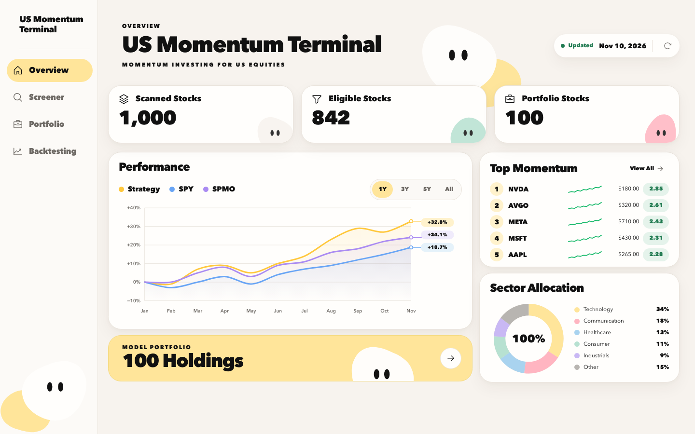

# US Momentum Terminal

[Open the live application](https://andyttc05.github.io/us-momentum-terminal/)

US Momentum Terminal is a research platform for screening US stocks, ranking them with a systematic
momentum strategy, and constructing a diversified model portfolio with historical backtests.



## What is momentum investing?

Momentum investing is based on a simple observation: stocks that have performed strongly over the
recent past may continue to outperform in the near future.

Rather than relying on personal opinions or predictions about individual companies, a momentum
strategy sets a repeatable rule. It measures past performance across many stocks, ranks them, and
selects the highest-ranked candidates.

## How the strategy works

### 1. Select the stock universe

The terminal starts with a defined universe of eligible US common stocks. It excludes securities
outside the universe rules, such as non-US listings, securities below the minimum price, and stocks
without enough reliable price history or liquidity.

### 2. Measure momentum

The strategy uses **12–1 momentum**:

```text
Momentum = (Price 1 month ago / Price 12 months ago) - 1
```

This measures approximately twelve months of performance while intentionally leaving out the most
recent month. The skip helps reduce the influence of short-term price reversals. Adjusted prices are
used so dividends and splits do not create artificial performance changes.

### 3. Score and rank stocks

The momentum return is adjusted for the stock’s daily price volatility. Stocks with stronger
performance and calmer price paths receive higher risk-adjusted scores. Those scores become a
cross-sectional Momentum Score, and eligible stocks are ranked from strongest to weakest.

### 4. Construct the portfolio

The model selects the highest-ranked stocks. Portfolio weights combine:

```text
Float-adjusted market capitalization × Momentum Score
```

Stronger momentum and larger investable market capitalization both increase a stock’s allocation.
The square-root size adjustment prevents the largest companies from dominating the portfolio.

### 5. Rebalance

The active model portfolio is reviewed twice a year, using the March and September market signals.
At a rebalance, holdings are updated to reflect the latest rankings and portfolio rules.
Between rebalances, the active holdings remain fixed while the ranked momentum list continues to
update.

## Portfolio rules

| Setting | Method |
| --- | --- |
| Target holdings | 100 |
| Momentum method | 12–1 Momentum |
| Weighting | Float-adjusted market cap × Momentum Score |
| Rebalancing | Semiannual, March and September |
| Maximum single-stock weight | 9% |
| Maximum sector-group weight | 35% |
| Investment allocation | Fully invested |

The constraints limit concentration in one company or one part of the market. A portfolio that
cannot satisfy the rules is reported as unavailable rather than silently changing the rules.

## Features

- **Overview:** market breadth, portfolio summary, leading stocks, and sector allocation.
- **Screener:** ranked stocks with search, filters, sorting, and export.
- **Portfolio:** model holdings, target weights, allocation, and rebalancing history.
- **Backtesting:** historical runs with configurable capital, cash flows, dividends, and schedules.
- **Stock Analysis:** price history, momentum measures, and historical ranking information.
- **Settings:** strategy and backtest configuration.

## Backtesting

A backtest applies the strategy’s rules to historical market data to show how the process would have
behaved. Results are compared with the S&P 500 through SPY and the S&P 500 Momentum ETF through SPMO.

Historical performance is **backtested performance**, not live portfolio performance and not a
promise of future results. The models include transaction costs but do not include taxes, market
impact, or delisting returns.

## Data and methodology

The primary market-data source is Yahoo Finance. A Python pipeline validates prices, calculates
momentum, constructs portfolios, and runs backtests. GitHub Actions publishes compact JSON files to
GitHub Pages for the React application.

Data updates on a schedule. The browser shows the last valid publication while checking for a newer
one; a failed refresh keeps the previous snapshot available.

Market data may be delayed, incomplete, or temporarily unavailable. The detailed methodology,
portfolio rules, accounting conventions, and research limitations are documented in
[METHODOLOGY.md](docs/METHODOLOGY.md). Data operations are described in
[DATA_PIPELINE.md](docs/DATA_PIPELINE.md), and setup instructions are in
[DEVELOPMENT.md](docs/DEVELOPMENT.md).

## Disclaimer

US Momentum Terminal is for education and research only. It does not provide financial advice or
guarantee investment returns. Past performance does not guarantee future results.
