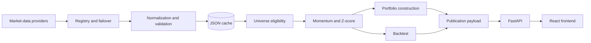

# Data Service

The `data-service` package is the Python FastAPI backend for US Momentum Terminal. It retrieves and
normalizes market data, calculates momentum metrics, builds the constrained model portfolio, runs
the historical backtest, and serves the React application.

## Architecture



The browser never receives provider credentials and never contacts a provider directly.

## Run

From the repository root:

```bash
npm run data:install
npm run data:serve
```

The service listens on `http://127.0.0.1:8787/`. Vite proxies `/api` to this address during local
development and preview.

## Endpoints

| Method | Path | Purpose |
| --- | --- | --- |
| GET | `/api/health` | Service state, market clock, cache age and provider health |
| GET | `/api/providers` | Provider roles and availability |
| GET | `/api/snapshot` | Complete dashboard publication |
| GET | `/api/stock/{ticker}` | Stock detail, price history and rank history |
| GET | `/api/bars/{ticker}?days=N` | Normalized daily bars |
| GET | `/api/probe` | Last recorded provider probe |
| GET | `/api/config` | Non-secret runtime configuration |
| POST | `/api/provider` | Select a provider and rebuild the publication |
| POST | `/api/refresh` | Start a forced background refresh |

## Universe

The current live list contains 200 unique common stocks:

- 108 audited core symbols.
- 92 sector-balanced additions from a 200-symbol S&P MidCap 400 candidate pool.

The historical backtest intentionally remains on the 108-symbol audited core. This is a curated
research universe, not a complete exchange master.

## Eligibility

A stock enters momentum scoring only after passing:

- Provider-verified common-stock security type.
- NYSE, NASDAQ, or NYSE American listing.
- USD currency and a common latest observation date.
- At least 210 daily observations.
- Latest raw close of at least $5.
- At least $2 million average daily dollar volume over 63 sessions.
- At least 253 valid adjusted-close observations for the full 12–1 window.

Missing adjusted closes are not replaced with raw closes.

## Momentum

```text
momentum_12_1 = P(t-21) / P(t-252) - 1
daily_volatility = sample standard deviation of 252 daily returns
risk_adjusted = momentum_12_1 / daily_volatility

Z = (risk_adjusted - population mean) / population standard deviation
Z = clip(Z, -3, 3)

Score = 1 + Z          when Z > 0
Score = 1 / (1 - Z)    when Z < 0
Score = 1              when Z = 0
```

## Portfolio

The model keeps the top 100 momentum-eligible stocks with current verified float shares. Raw weights
are:

```text
float-adjusted market cap × Momentum Score
```

Normalized raw weights are redistributed under a 9% stock cap and a 35% constraint-sector-group cap.
The solver returns an unavailable state with a reason when a valid fully invested portfolio cannot
be constructed.

## Backtest

Signals form at the final March and September sessions. Trades execute at the next available
adjusted close, holdings are marked daily, and the historical book is equal-weighted.

- Transaction cost: 0.10% of traded notional.
- Slippage: 0.00%.
- Benchmarks: SPY and SPMO.
- Sharpe risk-free rate: 0%.

The historical core has no point-in-time constituents, delisting-return model, or historical float
capitalization. The result is an exploratory research proxy.

## Providers and Cache

The default provider order is `yahoo,twelvedata,fmp`. Missing-key adapters are skipped. Stooq is
implemented but excluded from the default chain because it is unadjusted and commonly blocked.

Yahoo history is loaded in bounded 40-symbol batches. A provider registry records health,
provenance, backup use, retries and circuit-breaker state.

Caches are atomic JSON files under `data-service/cache/`. Default TTLs:

| Data | TTL |
| --- | --- |
| Bars while market open | 15 minutes |
| Bars while market closed | 6 hours |
| Quote metadata | 24 hours |
| Publication and stock detail | 15 minutes |

The service returns a verified seed or cached publication while a background refresh runs, or a
warming/error payload when no verified snapshot exists.

## Tests

```bash
npm run data:test
npm run data:verify
npm run data:audit
npm run data:sensitivity
```

`data:verify`, `data:audit`, and `data:sensitivity` require a working data service or cached evidence.
