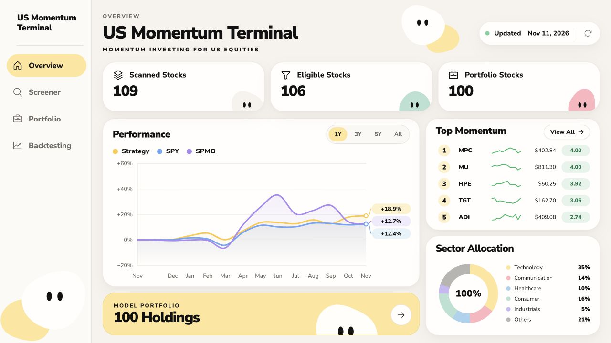
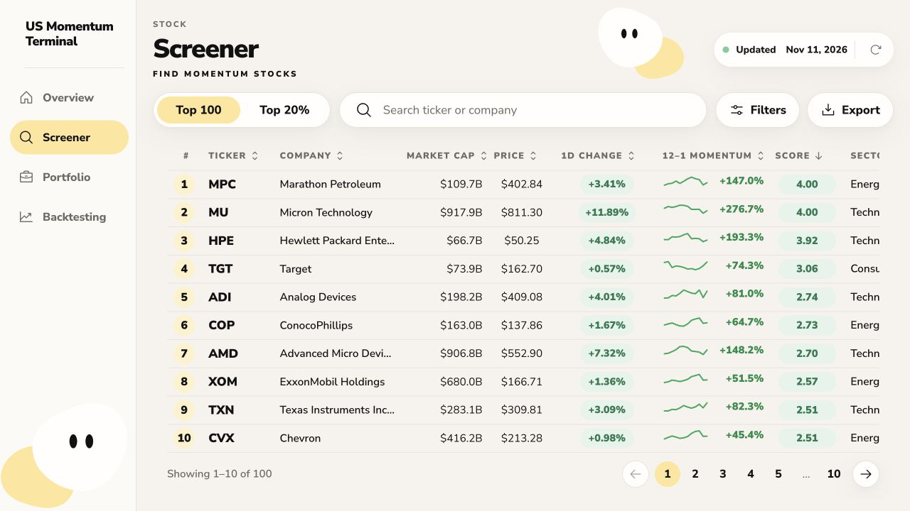
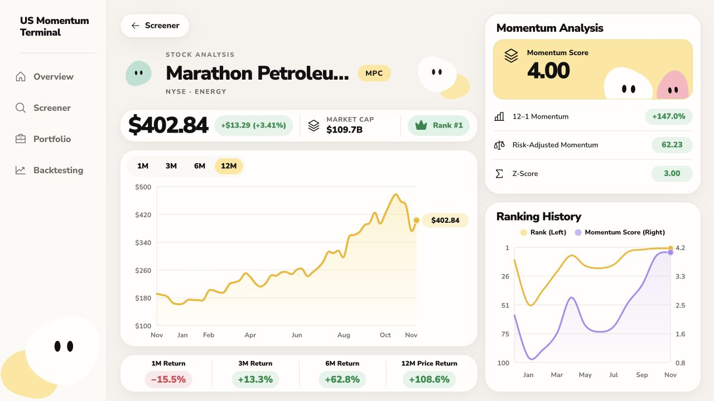
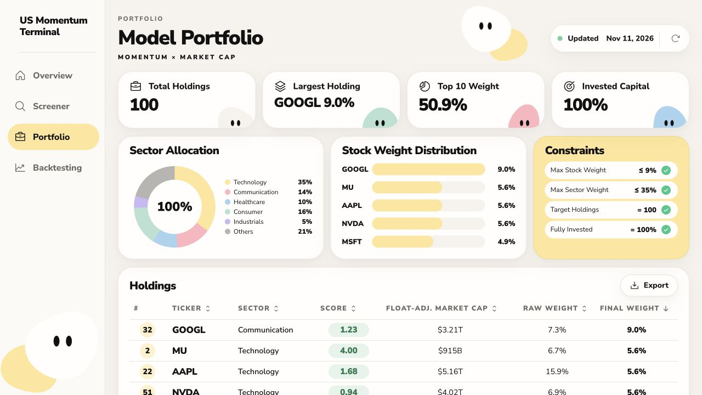
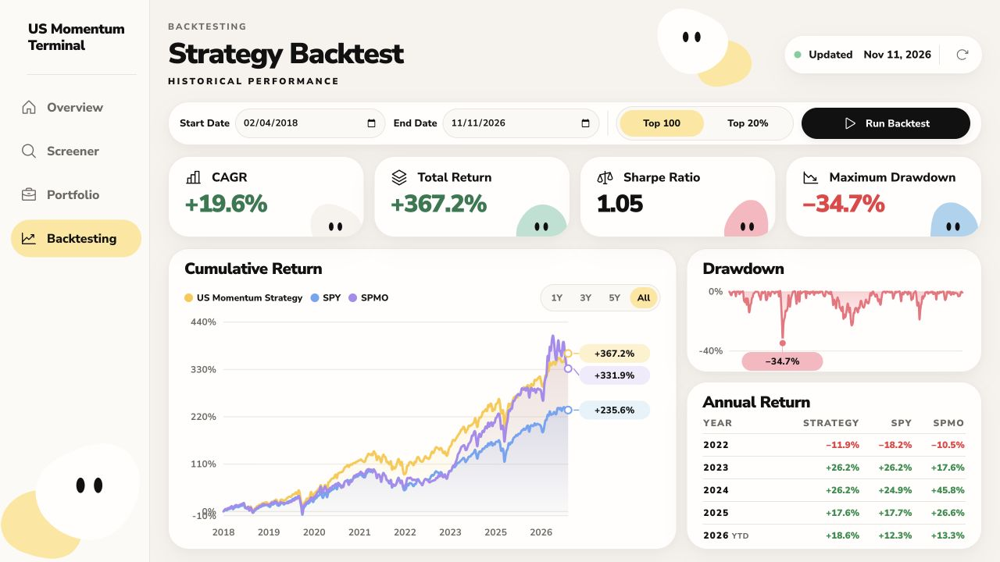
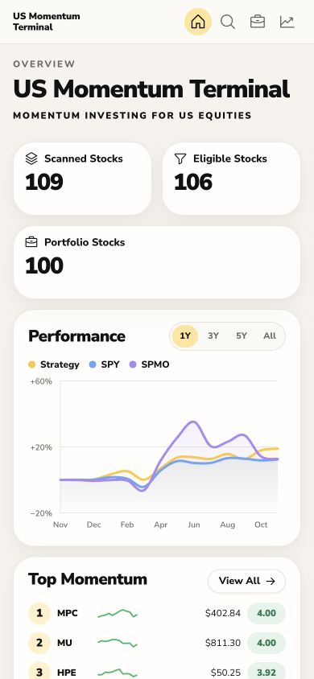
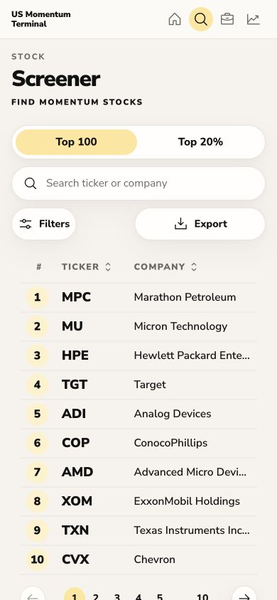

# Product UI Audit

Audit date: 12 November 2026  
Focus: preserve the approved terminal design while checking the core research flow  
Viewport: desktop 1280 × 720 and mobile 390 × 844

## Overall Verdict

The established visual direction remains intact. Navigation, stock drill-down, pagination, data
controls and CSV downloads work without browser console errors. Responsive layouts remain readable
at 390px. Two presentation risks remain: mobile intentionally omits the update bar, and the stock
table requires horizontal scrolling on narrow screens.

## 1. Overview

**Health: Strong**

- KPIs state scanned, eligible and portfolio counts consistently.
- Performance, top momentum and sector allocation are visible without competing priorities.
- Refreshing and provider timeliness are visible on desktop.
- No broken chart or missing data state appeared.

## 2. Screener

**Health: Strong**

- The Top 100 view now contains exactly 100 rows.
- Rank remains the strategy rank when the table is sorted by another column.
- Search, filters, pagination and export are present.
- The full CSV downloaded with 100 data rows.
- At smaller widths, non-priority columns require horizontal table scrolling.

## 3. Stock Analysis

**Health: Strong**

- Stock navigation used the encoded route and preserved the Screener as the return destination.
- Price chart, return strip, momentum analysis and rank history rendered together.
- Market cap and score match the shared snapshot used by Screener.
- The page title now reflects the active route for browser and screen-reader context.

## 4. Portfolio

**Health: Strong after data-label correction**

- All four constraints are visually confirmed in the live payload.
- The page now explicitly says Momentum × Float-Adj. Cap.
- The holdings export contains all 100 holdings.
- The export's float-adjusted market-cap column now writes the float-adjusted value rather than the
  ordinary company cap.

## 5. Backtesting

**Health: Strong**

- Date fields, portfolio mode, period controls, cumulative return, drawdown and annual return render.
- The visible All-period total now includes the initial transaction cost and matches the service
  metric.
- The page presents historical performance clearly; the detailed methodology and limitations remain
  in the strategy report.

## 6. Mobile Overview And Screener

**Health: Good, with two disclosed limits**

- The one-column layout, two-column KPI group and compact navigation remain usable.
- Icon-only navigation items now retain accessible names.
- Stock tables retain their query, filter and pagination structure via horizontal scrolling.
- The desktop freshness/update bar is intentionally hidden below the phone breakpoint. Provider
  status remains in the API payload but is not directly visible in the phone header.

## Accessibility And Evidence Limits

- Major buttons and links have accessible names in the inspected flow.
- Charts expose descriptive image labels.
- The screenshot review cannot prove full WCAG compliance.
- Keyboard-only traversal, screen-reader reading order and color-contrast ratios still require a
  dedicated accessibility test.
- The mobile table's horizontal scroll behavior is visible, but the screenshot alone does not prove
  that users understand the overflow affordance.

## Highest-Value Follow-Up

Add a compact mobile freshness summary near the page header. It would preserve the current visual
system while making provider delay or failure visible at the same breakpoint where the full update
bar is currently hidden.
