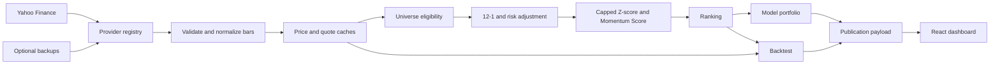

# US Momentum Terminal: Technical Documentation

Version: 1.0  
Audit date: 12 November 2026

## 1. Project Summary

US Momentum Terminal is a local single-page application and quantitative market-data service for
screening, ranking and studying a US equity momentum strategy.

### Main Capabilities

- Fetch and normalize daily OHLCV and adjusted-close history.
- Validate, de-duplicate and provenance-tag provider records.
- Apply universe, liquidity and momentum-history eligibility rules.
- Calculate 12-1, 3M, 6M and 12M momentum.
- Calculate daily and annualized volatility and risk-adjusted momentum.
- Create cross-sectional Z-scores and Momentum Scores.
- Rank stocks and build constrained model portfolios.
- Run semiannual historical simulations against SPY and SPMO.
- Serve dashboard, stock-detail and bar APIs.
- Render five responsive application pages and export CSV files.

### Technology Stack

| Layer | Technology |
|---|---|
| Frontend | React 19, Vite 6, plain CSS, Phosphor icons |
| Data service | Python 3.11+, FastAPI, Uvicorn |
| Quantitative processing | pandas, NumPy |
| Primary market data | Yahoo Finance through `yfinance` |
| Optional backups | Twelve Data, Stooq, Financial Modeling Prep |
| Trading calendar | `exchange-calendars` with XNYS calendar |
| Persistence | JSON disk cache and provider preference file |
| Tests | Python `unittest`, Node test runner, live HTTP verification |

## 2. System Architecture

### Frontend

The frontend is a React SPA rooted in `frontend/src`.

- `App.jsx` composes the route shell and mounted pages.
- `router.jsx` implements a small History API router for `/`, `/screener`, `/portfolio`,
  `/backtesting` and `/stock/:ticker`.
- `MarketProvider.jsx` performs one shared snapshot fetch, periodic revalidation and manual refresh.
- `client.js` wraps `/api` requests, timeouts and transport errors.
- Page components render the five application views.
- Shared chart, table, pagination, navigation and status components live in `components`.
- CSS tokens and responsive layout rules live in `styles`.

The Overview, Screener, Portfolio and Backtesting pages remain mounted and use the `hidden`
attribute when inactive. This preserves search, filters, sort and pagination state across stock
navigation.

### Backend

The FastAPI application is in `data-service/app`.

- `main.py`: HTTP endpoints, startup warm-up and error translation.
- `snapshot.py`: publication assembly, universe checks and UI payloads.
- `momentum.py`: price metrics, Z-score and Momentum Score.
- `portfolio.py`: raw weights, caps and infeasibility handling.
- `backtest.py`: semiannual signal timing, execution, costs and performance metrics.
- `universe.py` and `universe_expansion.py`: audited core, 200-symbol mid-cap candidate pool,
  92-symbol live selection and benchmark metadata.
- `clock.py`: NYSE session state and timeliness.
- `cache.py`: atomic JSON cache with TTL support.
- `models.py`: normalized bar, series and quote contracts.

### Provider Architecture

`providers/registry.py` owns the ordered provider chain, circuit breaker and runtime provider
selection. Each adapter implements:

- `fetch_series(symbol, years)`: daily OHLCV, adjusted close and provenance.
- `fetch_quote(symbol)`: name, sector, exchange, currency, market cap, float fields and quote type.

The default chain is Yahoo, Twelve Data, FMP. Stooq remains available when explicitly configured but
is omitted by default because its unadjusted response cannot feed the scoring engine. Providers
requiring keys are skipped when the key is missing.

Yahoo history requests are split into bounded 40-symbol batches with two concurrent batch workers.
Unresolved symbols move to a separate four-worker recovery pool with two transient retries and
exponential backoff. Missing adjusted closes invalidate the shallow batch result and trigger a
single-symbol refetch. Fast quote metadata and full portfolio fundamentals are separate phases.

The frontend never talks to a provider directly and never receives provider credentials.

### Quantitative Engine

The engine works with `SymbolSeries` objects containing a sorted `DatetimeIndex` and adjusted close,
raw close, volume, dividends and split columns.

The current snapshot scorer:

1. Validates adjusted-close availability and minimum observations.
2. Calculates each stock's risk-adjusted momentum.
3. Builds one eligible cross-section.
4. Calculates and caps the Z-score.
5. Applies the piecewise score.
6. Sorts deterministically and assigns ranks.

### Portfolio Construction Engine

The model portfolio:

1. Selects the top 100 eligible names with a verified float cap.
2. Multiplies float-adjusted cap by Momentum Score.
3. Normalizes those products to 100%.
4. Applies the 9% individual and 35% sector-group constraints by capped proportional
   redistribution.
5. Verifies total weight, stock cap, sector cap and holding count.

The solver returns a failure reason if too few holdings or sectors exist to reach 100% under the
caps.

The weighting solver retains the existing sector-group definitions. The returned holding sector and
legend now expose the provider-backed detailed categories, so Financials, Energy, Materials,
Utilities and Real Estate are no longer collapsed into "Others" in presentation.

### Backtesting Engine

The historical engine uses adjusted close as its price series. It forms signals at the final March
and September trading sessions and executes at the next session. It applies costs at formation and
each rebalance, computes daily portfolio values and reports drawdown and calendar-year results.

The historical book is equal-weighted because point-in-time float caps are unavailable.

### Database And Persistence

There is no relational database. The service persists:

- Provider preference in `data-service/cache/state.json`.
- Daily bars by provider and symbol.
- Quote metadata.
- Publication snapshots.
- Stock detail cache.
- Derived monthly rank history.

Writes are atomic through a temporary file followed by `os.replace`. Cache entries include a
`stored_at` timestamp and are considered expired according to the endpoint or data type TTL.

`GET /api/snapshot` never waits for a cold rebuild. It returns fresh data immediately when current,
returns stale data with a visible `cached` state while a background rebuild runs, or returns a
lightweight `warming` payload when no cache exists. The browser polls during the background state.
Expired bar and quote caches are retained as fallback and are clearly marked rather than serving
them as fresh.

The release also includes a fully verified 198-stock publication seed. A new process with no disk
cache returns that seed as cached data while refreshing, avoiding an empty cold-start screen without
inventing live values.

## 3. Data Flow



Publication assembly occurs once per cache window:

1. Load stock and benchmark series in bounded batches.
2. Normalize and validate bars.
3. Fetch fast quote metadata, then full float fundamentals for portfolio candidates.
4. Apply common as-of and universe checks.
5. Score momentum.
6. Build current portfolio, ranks and backtests.
7. Write the publication object atomically.
8. Return it to the browser.

## 4. Data Model

### Stock Information

Display stock rows include:

- `ticker`, `company`, `sector`, `exchange`
- `price`, `change`, `changeAbsolute`
- `marketCap` and market-cap currency/source metadata
- `floatShares`, `floatMarketCap`
- `averageDailyDollarVolume3m`

### Normalized Historical Bar

```text
symbol
date
open, high, low, close
adjusted_close
volume
market_cap (normally null in daily bars)
dividends
stock_splits
data_source
last_updated
```

### Momentum Metrics

```text
momentum_1m
momentum_3m
momentum_6m
momentum_12m
momentum_12_1
volatility (annualized %)
daily_volatility
risk_adjusted
zScore
score
rank
observations
```

### Portfolio Holding

```text
rank
ticker
company
sector
score
momentum_12_1
market_cap
float_market_cap
floatAdjustedMarketCap (display string)
rawWeight
finalWeight
```

### Benchmark Prices

SPY, SPMO and QQQ are stored as normalized price series in the same cache structure but are
excluded from stock ranking and universe eligibility.

### Backtest Result

The in-memory result includes:

- Daily strategy NAV and drawdown.
- Daily benchmark NAV.
- Monthly strategy and benchmark series.
- Calendar-year returns.
- Rebalance signal/execution dates, leaders, turnover and cost.
- CAGR, total return, annualized volatility, Sharpe, drawdown and turnover metrics.

## 5. Quantitative Methodology

### Universe

The implemented checks are:

- Provider-verified common-stock security type.
- NYSE, NASDAQ or NYSE American exchange.
- USD currency.
- Last close of at least $5.
- At least 210 trading observations.
- At least $2 million average daily dollar volume over 63 sessions.
- Latest observation equal to the common cross-sectional as-of date.

The live candidate universe contains 200 unique symbols: 108 in the audited core and 92 additions
selected with static sector quotas from a 200-stock approved S&P MidCap 400 pool. Exchange tags were
checked against Nasdaq Trader listing files. It is broader than the original 109-symbol scan but
still not a complete exchange master.

The historical backtest deliberately remains on the 108-symbol audited core rather than applying
today's 92 additions retrospectively.

### Momentum

```text
12-1 momentum = P(t-21) / P(t-252) - 1
```

Only adjusted closes enter the calculation. A stock with insufficient observations is excluded from
scoring.

### Risk Adjustment

```text
sigma_daily = sample standard deviation of 252 daily returns
risk_adjusted = decimal 12-1 return / sigma_daily
```

### Cross-Sectional Z-Score

```text
z = (risk_adjusted - mean) / population standard deviation
z = clip(z, -3, +3)
```

Zero dispersion produces neutral Z = 0.

### Score

```text
Score = 1 + z          when z > 0
Score = 1 / (1 - z)    when z < 0
Score = 1              when z = 0
```

### Portfolio Weight

```text
raw_i = float_adjusted_market_cap_i × score_i
preliminary_weight_i = raw_i / sum(raw) × 100
```

The final weights are the capped proportional allocation described below.

## 6. Portfolio Construction

### Selection

Sort eligible stocks by score, then risk-adjusted momentum and ticker for deterministic ties. Select
the first 100 with a positive float-adjusted market cap.

### Constraint Solver

For candidate scaling factor `lambda`:

1. Give each name `min(9%, lambda × preliminary weight)`.
2. Sum each solver sector group.
3. Scale any sector above 35% back to 35%.
4. Bisect `lambda` until the total allocation reaches 100%.
5. Validate that all constraints still hold.

This produces a capped proportional redistribution while preserving relative raw weights where the
caps permit.

### Infeasibility

The portfolio is unavailable if:

- There are fewer than 12 holdings, making a 9% per-name cap unable to reach 100%.
- There are fewer than three effective sector groups, making a 35% sector cap unable to reach 100%.
- The solver cannot converge.
- No positive float caps exist.

The API returns a reason rather than a constraint-breaking book.

### Rebalancing

The live ranking is recomputed from each new publication. Portfolio trades are not generated by
daily ranking changes. The intended official portfolio rebalance remains March and September.

## 7. Backtesting Architecture

### Timeline

```text
March/September final close:
    calculate signal

Next available session:
    execute at adjusted close

Between execution dates:
    mark holdings to market daily

Next March/September:
    repeat
```

### Execution And Costs

- Initial formation buys the target book.
- Rebalance traded notional is the sum of absolute changes in position values.
- Cost rate is 0.10% of traded notional.
- Slippage rate is 0.00%.
- Costs reduce NAV only when trades occur.

### Benchmark Alignment

SPY and SPMO are normalized from their first adjusted close on the same date as the first executable
strategy book. Their end date matches the strategy's final date.

### Performance

Daily strategy values are used for total return, CAGR, annualized volatility, Sharpe and maximum
drawdown. Monthly sampling is used for charts. Calendar-year returns use the previous year-end as
the base where available.

Sharpe uses daily excess returns with an explicit 0% annual risk-free rate and `sqrt(252)` scaling.

### Known Backtest Gap

The simulation does not use historical float-adjusted market cap, current portfolio weighting,
point-in-time constituents or a delisting-return model. It is a ranking-history research proxy.

## 8. Frontend Structure

### Pages

- `OverviewPage.jsx`: KPIs, performance, top momentum, sector allocation.
- `ScreenerPage.jsx`: Top 100/Top 20%, search, filters, sorting, pagination, export.
- `PortfolioPage.jsx`: model summary, sector allocation, constraints, holdings, export.
- `BacktestingPage.jsx`: date/range controls, cumulative return, drawdown, annual returns.
- `StockAnalysisPage.jsx`: price history, returns, momentum metrics and rank history.

### Shared Components

- Sidebar navigation.
- Page header and update bar.
- KPI and dashboard cards.
- Performance, price, rank and drawdown charts.
- Sector donut.
- Pagination.
- Toast and status surfaces.

### Navigation

All stock URLs are generated through `stockPath(ticker)` and opened through
`useStockNavigation()`. The origin page is stored in History API state so the Stock Analysis back
button returns to the originating page.

### Responsive Design

The layout uses shared breakpoint rules:

- Desktop: full sidebar and multi-column dashboard.
- Tablet: compact sidebar and stacked primary layout.
- Phone: top navigation, one-column main flow and horizontally scrollable stock tables.

The page title is updated with the active route for browser and assistive-technology context.

## 9. Folder Structure

```text
US_Momentum_Terminal/
├── README.md
├── package.json
├── package-lock.json
├── .env.example
├── .gitignore
├── data-service/
│   ├── app/
│   │   ├── providers/
│   │   ├── main.py
│   │   ├── snapshot.py
│   │   ├── momentum.py
│   │   ├── portfolio.py
│   │   ├── backtest.py
│   │   └── ...
│   ├── tests/
│   │   ├── test_quantitative.py
│   │   ├── verify.py
│   │   ├── audit_data.py
│   │   ├── strategy_sensitivity.py
│   │   └── provider_probe.py
│   ├── docs/
│   └── cache/
├── frontend/
│   ├── src/
│   │   ├── api/
│   │   ├── assets/
│   │   ├── components/
│   │   ├── styles/
│   │   ├── utils/
│   │   └── *Page.jsx
│   ├── tests/
│   ├── worker/
│   ├── scripts/
│   ├── package.json
│   └── package-lock.json
└── docs/
    ├── DATA_AUDIT_REPORT.md
    ├── STRATEGY_VALIDATION_REPORT.md
    ├── PROJECT_TECHNICAL_DOCUMENTATION.md
    ├── FINAL_VALIDATION_REPORT.md
    ├── PRODUCT_UI_AUDIT.md
    ├── audit-screenshots/
    ├── development-history/
    └── source-brief/
```

Generated directories such as `.venv-datatest`, `node_modules`, `frontend/dist`,
`data-service/cache` and Python bytecode are ignored and may be regenerated.

## 10. Configuration And Environment

### Frontend

Vite proxies `/api` to `http://127.0.0.1:8787`. Override with `DATA_SERVICE_URL` when starting the
preview server.

### Data Service

| Variable | Default | Purpose |
|---|---|---|
| `DATA_SERVICE_HOST` | `127.0.0.1` | Bind host |
| `DATA_SERVICE_PORT` | `8787` | Port |
| `DATA_PROVIDER_CHAIN` | `yahoo,twelvedata,fmp` | Provider order |
| `DATA_HISTORY_YEARS` | `10` | Requested history depth |
| `DATA_REQUEST_TIMEOUT` | `25` | HTTP timeout seconds |
| `DATA_HISTORY_BATCH_SIZE` | `40` | Symbols per history batch |
| `DATA_HISTORY_BATCH_WORKERS` | `2` | Concurrent history batches |
| `DATA_SERIES_FETCH_WORKERS` | `4` | Per-symbol recovery concurrency |
| `DATA_QUOTE_WORKERS` | `4` | Quote metadata concurrency |
| `DATA_RETRY_ATTEMPTS` | `2` | Transient retry limit |
| `DATA_RETRY_BASE_SECONDS` | `0.75` | Exponential-backoff base |
| `DATA_WARM_TIMEOUT` | `180` | Refresh spinner timeout seconds |
| `DATA_CACHE_DIR` | `data-service/cache` | Cache root |
| `DATA_TTL_BARS_INTRADAY` | `900` | Open-market bar TTL |
| `DATA_TTL_BARS_CLOSED` | `21600` | Closed-market bar TTL |
| `DATA_TTL_META` | `86400` | Quote metadata TTL |
| `DATA_TTL_SNAPSHOT` | `900` | Publication TTL |

Optional secrets:

- `TWELVEDATA_API_KEY`
- `FMP_API_KEY`

Additional documented but inactive research keys:

- `ALPHAVANTAGE_API_KEY`
- `FINNHUB_API_KEY`
- `POLYGON_API_KEY`

Secrets belong only in the root `.env`, which is ignored and loaded only by the data service.

## 11. API Surface

| Method | Endpoint | Purpose |
|---|---|---|
| GET | `/api/health` | Service, clock, cache and provider state |
| GET | `/api/snapshot` | Full dashboard publication |
| GET | `/api/stock/{ticker}` | Stock detail, weekly history and rank history |
| GET | `/api/bars/{ticker}?days=N` | Normalized bars |
| GET | `/api/providers` | Provider chain and status |
| GET | `/api/probe` | Last saved provider probe |
| POST | `/api/provider` | Switch active provider and rebuild |
| POST | `/api/refresh` | Force a provider rebuild |
| GET | `/api/config` | Non-secret runtime configuration |

## 12. Testing And Quality Assurance

### Automated Unit Tests

`data-service/tests/test_quantitative.py` covers:

- Piecewise score boundaries.
- Z-score capping.
- Zero dispersion.
- 12-1 date selection.
- Daily risk adjustment.
- Adjusted-close-only frame construction.
- Portfolio raw-weight formula.
- Constraint feasibility.
- NYSE holiday and early-close detection.
- Semiannual execution and transaction costs.
- 200-symbol live source uniqueness and 11-sector selection coverage.
- Separation of the expanded live scan from the historical backtest core.

### Live Integration Verification

`verify.py` checks:

- One cross-sectional date.
- Momentum-observation minimum.
- Non-null prices and finite scores.
- Ranking consistency.
- Independent AAPL, MSFT, NVDA, META and JPM momentum/volatility recomputation.
- Bar ordering, duplicates and adjusted flag.
- Portfolio caps and float-cap availability.
- Raw-weight formula.
- Backtest cost, March/September months and execution timing.
- Benchmark cross-provider prices.
- Source provenance.

### Data-quality And Sensitivity Tools

- `audit_data.py` writes structural and anomaly evidence.
- `strategy_sensitivity.py` writes scenario and period results.
- `provider_probe.py` records live provider capabilities.

### Build And Browser Checks

- Vite production build.
- Sites worker tests.
- Desktop page and stock navigation.
- Screener and portfolio CSV downloads.
- 390px responsive layout.
- Browser console error check.
- Search relevance, clearing and no-result behavior.
- Static row/sparkline center alignment and compact row height.
- Dynamic drawdown tick scales.
- Compact loading, partial, cached and service-error notice states.

### Known Test Gaps

- No automated visual-regression suite.
- No paid second-provider full-universe comparison.
- No point-in-time constituent or market-cap test.
- No live trading or order-execution tests.
- No formal performance attribution test.
- No long-duration soak test of provider quota and cache behavior.

## 13. Known Limitations And Future Improvements

### Genuine Limitations

- Curated rather than complete US universe.
- Current rather than point-in-time fundamentals.
- Equal-weight historical proxy.
- Survivorship and listing-selection bias.
- Unofficial primary provider.
- No stable security master for ticker changes.
- Some older core cache entries without complete per-row corporate-action metadata.
- 0% risk-free Sharpe assumption.

### Realistic Improvements

- Add point-in-time constituents and security identifiers.
- Add historical float shares and shares outstanding.
- Reproduce the constrained float-cap portfolio at each rebalance.
- Add delisting and merger return handling.
- Add paid backup providers and full cross-source tolerance checks.
- Add visual regression and accessibility automation.
- Add a configurable risk-free series and richer performance attribution.
