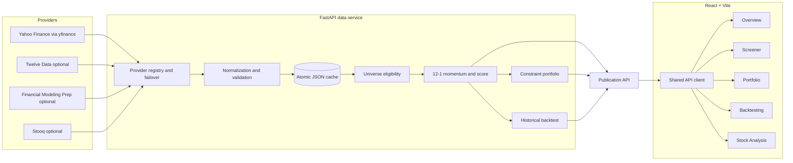

# Technical Documentation

Version: 1.1
Implementation date: 12 November 2026

## System Architecture



The frontend never contacts a market-data provider and never receives provider credentials. It calls
the FastAPI service. The service assembles one consistent publication object for the dashboard.

## Repository Layout

```text
.
├── .github/workflows/       # CI and Pages deployment
├── data-service/
│   ├── app/
│   │   ├── providers/       # Yahoo, Twelve Data, Stooq and FMP adapters
│   │   ├── main.py          # FastAPI routes and startup refresh
│   │   ├── snapshot.py      # Publication assembly
│   │   ├── momentum.py      # Price metrics, Z-score and score
│   │   ├── portfolio.py     # Weights and constraint solver
│   │   ├── backtest.py      # Historical simulation
│   │   ├── universe.py      # Core list and universe metadata
│   │   └── universe_expansion.py
│   ├── docs/                # Provider report and generated evidence
│   ├── seed/                # Verified cold-start publication
│   └── tests/               # Unit and live verification tools
├── docs/
│   ├── screenshots/
│   └── *.md                 # Public project documentation
├── frontend/
│   ├── src/
│   ├── tests/
│   ├── worker/
│   └── scripts/
└── package.json
```

## Frontend

### Application Shell and Navigation

The frontend is a React 19 single-page application built with Vite 6. `frontend/src/App.jsx` mounts
the Overview, Screener, Portfolio, and Backtesting pages and conditionally mounts Stock Analysis.
The four primary pages remain mounted and hidden when inactive, preserving search, filters, sorting,
and pagination state.

`frontend/src/router.jsx` implements a small History API router for:

- `/`
- `/screener`
- `/portfolio`
- `/backtesting`
- `/stock/:ticker`

The router handles the GitHub Pages repository base path and updates the document title.

### API Communication

`frontend/src/api/client.js` wraps `fetch` with timeouts and user-facing transport errors.
`VITE_API_BASE_URL` selects the hosted API for deployment; local builds use `/api` through the Vite
proxy.

`frontend/src/api/MarketProvider.jsx` owns the shared snapshot request, five-minute revalidation,
manual refresh, background warming state, and provider selection. Stock Analysis uses a separate
detail request. An optional `VITE_STATIC_SHOWCASE=true` mode supports a disconnected visual build.

Refresh completion notices are event-driven from the shared data state. Loading and updating cycles
render only in the top update bar; the dark toast is shown once a final success, cached, partial or
failed state is known. Retry starts a new completion cycle rather than relying on timers to infer
whether work has finished.

### Pages and Charts

| Page | Main content |
| --- | --- |
| Overview | Three KPI cards, monthly strategy/SPY/SPMO performance, Top Momentum, sector donut |
| Screener | Top 100/Top 20%, search, filters, sorting, pagination and CSV export |
| Portfolio | Summary KPIs, sector allocation, top weights, constraints and holdings export |
| Backtesting | Range controls, strategy/benchmark chart, drawdown, annual returns and assumptions |
| Stock Analysis | Price chart, return summaries, momentum metrics and month-end rank history |

Charts are implemented with responsive SVG components. Tables use semantic HTML with explicit sort
controls and accessible labels. CSS is split into shared tokens/components/layout files and
page-specific files.

### Responsive Layout

The application uses a fixed labelled sidebar on desktop, a compact icon sidebar on tablet widths,
and a top navigation bar on phones. Page headers and the main content grid reflow to one or two
columns as space decreases. Wide stock tables remain horizontally scrollable on small screens.

The sidebar includes a secondary About navigation item that opens a responsive native modal. The
modal supports close-button, Escape-key and outside-click dismissal, keeps background scrolling
locked while open, and links to this document and the README without adding a new route or changing
the dashboard layout.

### CSV Export

The Screener exports the currently filtered result set. The Portfolio export validates portfolio
completeness and constraints before writing all holdings. Exports include rank and
float-adjusted-market-cap values and use UTF-8 CSV files.

## Python Backend

### FastAPI Service

`data-service/app/main.py` creates the FastAPI application, configures CORS for local and GitHub
Pages origins, starts a background publication warm-up, and exposes the API. `snapshot.py`
coordinates data retrieval, eligibility, scoring, portfolio construction, and backtesting.

### Provider Integration

`providers/registry.py` maintains an ordered provider chain, records health and provenance, and
implements failover and a circuit breaker. The configured default is:

```text
yahoo, twelvedata, fmp
```

Adapters that require missing keys are skipped. Stooq is implemented but omitted by default because
its series are unadjusted. Yahoo history is requested in bounded batches with controlled
concurrency; unresolved symbols move to a per-symbol recovery pool with limited retry and
exponential backoff.

### Validation and Cleaning

Provider rows are mapped to `NormalizedBar` records. The validation path:

- Requires a ten-character ISO date.
- Drops rows without a positive raw close.
- Drops impossible high/low relationships.
- Collapses duplicate dates, retaining the most recently fetched row.
- Sorts observations chronologically.
- Preserves source and fetch timestamps.
- Requires adjusted closes for momentum scoring.

The universe pass then applies provider-verified security type, exchange, currency, history, price,
and liquidity checks.

### Historical Prices

The default request spans ten years of daily data. The application uses `Adj Close` for momentum,
benchmarks, Sparkline trends, and backtesting. Raw close is retained for the displayed latest price
and for historical liquidity checks.

### Cache and Background Refresh

There is no relational database. The service uses atomic JSON files under `data-service/cache/`:

- Provider-adjusted bar caches by symbol and requested history.
- Quote metadata.
- Publication snapshots.
- Stock-detail records.
- Derived month-end rank history.
- Provider preference state.

Default TTLs are 15 minutes for bars while the market is open, six hours otherwise, 24 hours for
quote metadata, and 15 minutes for publication and detail data. Cached rows retain source and age
metadata.

`GET /api/snapshot` does not wait for a cold provider rebuild. It returns current data when valid,
serves stale or seed data as explicitly cached while refreshing, or returns a warming/error payload
when no verified payload exists.

## Data Sources and Collection

### Curated Universe

The live source universe contains 200 unique symbols:

- 108 audited core stocks used by the historical backtest.
- 92 additions selected from a 200-symbol S&P MidCap 400 candidate pool.

The additions use static sector quotas and were selected without considering momentum or historical
performance. Exchange metadata was checked against listed-security references. This is a curated
research list, not a complete exchange master and not a daily scan of every US stock.

### Yahoo Finance

Yahoo is the default source and the only provider exercised for the current full universe. It
supplies adjusted and unadjusted OHLCV, split and dividend fields when available, and current quote
metadata. Yahoo access runs through the unofficial `yfinance` client and remains subject to provider
rate limits and availability.

### Optional Providers

| Provider | Role | Notes |
| --- | --- | --- |
| Twelve Data | Backup | Key required; free-plan quotas and adjusted-close limitations |
| Financial Modeling Prep | Backup | Key required; adjusted EOD source |
| Stooq | Optional adapter | Unadjusted CSV; not in default chain |
| Alpha Vantage, Finnhub, Polygon | Research/configuration only | No production adapter registrations |

### Verified, Cached and Missing Values

Every stock row includes a source label and fetch timestamp. Publication metadata classifies the
overall state as `fresh`, `cached`, `partial`, `empty`, `warming`, or `error`. A stock unavailable
from every provider is excluded and reported. Missing prices, market caps, or scores render as
`—`; they are never replaced with a synthetic value.

## Quantitative Methodology

### Universe Eligibility

The implemented rules are:

1. Include only symbols in the curated 200-symbol list.
2. Require the latest series date to equal the common cross-sectional date.
3. Require the curated security type to be common stock.
4. Require provider metadata to classify the security as equity/common stock.
5. Require NYSE, NASDAQ, or NYSE American.
6. Require USD currency.
7. Require at least 210 daily observations.
8. Require the latest raw close to be at least $5.
9. Require at least $2,000,000 average daily dollar volume over 63 sessions.

### Momentum and Volatility

`TRADING_DAYS` is `1M=21`, `3M=63`, `6M=126`, `12M=252`, and the full scoring minimum is 253
observations.

```text
momentum_12_1 = P(t-21) / P(t-252) - 1

window = adjusted prices from t-252 through t
returns = daily percentage changes in window
daily_volatility = sample standard deviation(returns, ddof=1)
risk_adjusted = momentum_12_1 / daily_volatility
```

The displayed annualized volatility is `daily_volatility × sqrt(252) × 100`.

### Cross-Sectional Score

```text
Z = (risk_adjusted - population_mean) / population_standard_deviation
Z = clip(Z, -3, 3)

Score = 1 + Z          if Z > 0
Score = 1 / (1 - Z)    if Z < 0
Score = 1              if Z = 0
```

Zero dispersion produces neutral scores of 1. Stocks are ordered by descending score, then
descending risk-adjusted momentum, then ticker. Ranking is limited to momentum-eligible stocks.

## Portfolio Construction

The current model portfolio:

1. Keeps ranked stocks with a positive verified current float-adjusted market cap.
2. Selects the first 100 names.
3. Computes `raw_i = float_market_cap_i × score_i`.
4. Normalizes raw weights to 100%.
5. Applies a minimum of 9% or `lambda × preliminary weight` to each name.
6. Scales each solver sector group back to at most 35%.
7. Uses bisection to find a fully invested solution.

The solver groups Consumer Discretionary and Consumer Staples together as `Consumer`, and groups
Financials, Energy, Materials, Utilities, and Real Estate as `Others`. Technology, Communication,
Healthcare, and Industrials remain separate. These solver groups are stricter than displaying each
of the eleven provider sectors independently.

The returned portfolio is unavailable if there are too few holdings or sectors to reach 100% under
the caps, if no positive float caps exist, or if the solver cannot converge. The service never
returns a constraint-breaking book.

## Backtesting

The backtest uses adjusted closes and a historically eligible subset of the audited 108-stock core.
For every March and September signal:

1. Use the final available session in the month as the signal date.
2. Apply the $5, 210-observation, and $2 million 63-session liquidity checks using data available at
   that date.
3. Calculate the same 12–1 risk-adjusted momentum cross-section.
4. Select Top 100 or `ceil(eligible_count × 0.20)`.
5. Execute at the next available session close.
6. Equal-weight the selected stocks.
7. Mark holdings to market daily until the next rebalance.

Transaction cost is 0.10% of traded buy and sell notional. Slippage is 0.00%. SPY and SPMO are
normalized from their first matching adjusted close. Sharpe uses a 0% annual risk-free rate.

The main metrics are cumulative return, CAGR, annualized volatility, maximum drawdown, Sharpe,
annual returns, turnover, and cumulative transaction cost.

### Backtest Limitations

- No point-in-time constituents or complete delisted-security history.
- No historical float-adjusted market capitalization, so the book is equal-weighted.
- No stable security identifier for every historical ticker change or symbol reuse.
- No explicit delisting or merger return model.
- Current universe knowledge can create survivorship and selection bias.
- No taxes, market impact, capacity, financing, or execution model.
- Exploratory results do not prove future profitability.

The date controls on the website slice the stored backtest series. They do not rerun historical
signals for an arbitrary date window.

## API Endpoints

| Method | Endpoint | Purpose |
| --- | --- | --- |
| GET | `/api/health` | Service state, market clock, cache age, providers |
| GET | `/api/providers` | Provider roles, health and availability |
| GET | `/api/snapshot` | Complete dashboard publication |
| GET | `/api/stock/{ticker}` | Stock detail, returns and rank history |
| GET | `/api/bars/{ticker}?days=N` | Normalized daily bars |
| GET | `/api/probe` | Last recorded provider probe evidence |
| GET | `/api/config` | Non-secret public configuration |
| POST | `/api/provider` | Select a provider and rebuild the publication |
| POST | `/api/refresh` | Start a forced background refresh |

The snapshot contains `meta`, `universe`, `stocks`, `overview`, `portfolio`, `backtest`, and provider
status blocks. Responses use `Cache-Control: no-store` where live state must not be cached by an
intermediary.

## Configuration

| Variable | Default | Purpose |
| --- | --- | --- |
| `DATA_PROVIDER_CHAIN` | `yahoo,twelvedata,fmp` | Provider order |
| `DATA_HISTORY_YEARS` | `10` | Requested daily history |
| `DATA_REQUEST_TIMEOUT` | `25` | Provider request timeout |
| `DATA_HISTORY_BATCH_SIZE` | `40` | Primary batch size |
| `DATA_HISTORY_BATCH_WORKERS` | `2` | Concurrent batches |
| `DATA_SERIES_FETCH_WORKERS` | `4` | Per-symbol recovery concurrency |
| `DATA_QUOTE_WORKERS` | `4` | Quote metadata concurrency |
| `DATA_RETRY_ATTEMPTS` | `2` | Transient retry limit |
| `DATA_WARM_TIMEOUT` | `180` | Maximum visible refresh duration |
| `DATA_CACHE_DIR` | `data-service/cache` | Cache root |
| `VITE_API_BASE_URL` | `/api` | Frontend API base |

Optional provider keys are documented in `.env.example`.

## Deployment

GitHub Actions builds the frontend with:

```text
VITE_BASE_PATH=/us-momentum-terminal/
VITE_API_BASE_URL=https://us-momentum-data.onrender.com/api
```

The Pages workflow uploads `frontend/dist/client` and includes an SPA `404.html` fallback. The Python
service is deployed separately on Render. A CI workflow runs Python tests, frontend tests, the Sites
test, and the production build on pushes and pull requests.

## Testing

- `npm run data:test`: deterministic quantitative, constraint, calendar and backtest tests.
- `npm --prefix frontend run test:unit`: frontend utilities, data-state, sector presentation,
  CSV, search, Sites worker and build-output tests.
- `npm run data:verify`: live API integrity, recomputation and portfolio checks.
- `npm run data:audit`: cached-data structure and anomaly evidence.
- `npm run data:sensitivity`: exploratory scenario and period comparisons.
- `npm run build`: production frontend and Sites package.

Generated evidence is stored under `data-service/docs/`.
