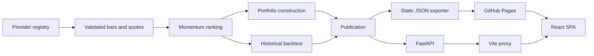

# Technical Documentation

## System overview

US Momentum Terminal has two supported execution modes:

- **Static production:** GitHub Actions builds the Python publication, writes JSON to
  `frontend/public/data/`, and deploys the React app to GitHub Pages.
- **Local/live:** React calls FastAPI through Vite's `/api` proxy while the Python service retrieves
  and caches provider data.

Both modes consume the same publication and stock-detail schemas.



See [DATA_PIPELINE.md](DATA_PIPELINE.md) for scheduling, validation, rollback and browser-cache
details.

## Repository layout

```text
data-service/app/
  providers/       Provider adapters and failover registry
  config.py        Non-secret runtime settings
  cache.py         Atomic JSON cache
  clock.py         NYSE session state and timeliness
  momentum.py      Ranking and momentum metrics
  portfolio.py     Constrained model portfolio
  backtest.py      Historical simulation
  macro.py         CPI-U loading
  snapshot.py      Publication and stock-detail builders
  main.py          FastAPI endpoints
data-service/scripts/
  export_static.py Validated GitHub Pages exporter
data-service/tests/
  test_*.py        Unit and contract tests
  *_probe/*audit   Live diagnostics and reproducible reports

frontend/src/
  api/             Static/live adapter, request dedupe and browser cache
  components/      Shared cards, charts, states, navigation and data dialog
  styles/          Tokens, shared layout and page CSS
  utils/           Formatting, calculations and chart helpers
  *Page.jsx        Five application screens
frontend/public/data/
  publication.json
  manifest.json
  stocks/*.json
```

## Frontend

The app uses a small history-API router. Main pages remain mounted while hidden so Screener filters,
sorting and pagination survive navigation to Stock Analysis. Stock Analysis loads only the selected
stock detail.

`MarketProvider` owns:

- publication state;
- initial browser-cache hydration;
- background update checks;
- last-valid fallback;
- update notices;
- stock-detail loading.

`client.js` selects `live` or `static` mode and deduplicates identical in-flight requests. It never
places provider keys in browser code.

The page shell renders independently of data. `getSectionState` resolves each card or section to
loading, ready, error or empty; existing cached data always wins over a refresh failure. Shared
`DataState`, `ChartState`, KPI skeleton and table-skeleton components preserve the approved card and
table footprints. This avoids page-level loading screens and prevents unrelated sections from being
removed by one request.

The update pill opens a Data & Cache dialog with the actual collection timestamp, market date,
provider, coverage and browser-cache time.

## Data sources

Yahoo Finance via `yfinance` is the default provider. It supplies daily OHLCV, adjusted closes,
dividends, splits and current quote metadata. Optional adapters are available for Twelve Data and
FMP; Stooq is disabled. Provider evidence is in
[data-service/docs/DATA_PROVIDERS.md](../data-service/docs/DATA_PROVIDERS.md).

The universe is curated: 108 audited core symbols plus 92 sector-balanced mid-cap additions. A
snapshot normally contains 198 eligible stocks after exclusions.

Validation rejects missing common dates, non-USD securities, non-common-stock quote types, prices
below $5, insufficient observations and stocks below the three-month liquidity threshold. Adjusted
closes are never replaced with raw closes.

## Momentum

```text
12–1 momentum            = P(t−21) / P(t−252) − 1
daily volatility         = sample std-dev of 252 trailing daily returns
risk-adjusted momentum   = momentum / daily volatility
Z                        = (value − mean) / population std-dev
Z                        = clip(Z, −3, +3)

Score = 1 + Z          if Z > 0
Score = 1 / (1 − Z)    if Z < 0
Score = 1              if Z = 0
```

The ranking needs at least 253 observations. The Screener supports Top 100 and Top 20; both are exact
stock counts.

## Portfolio

The model book selects the highest-ranked eligible stocks with verified float shares. Raw weight is:

```text
float-adjusted market cap × Momentum Score
```

A capped solver applies a 9% stock limit and a 35% constraint-sector-group limit. If the constraints
cannot be satisfied, the portfolio is unavailable with an explanatory reason.

The publication contains `portfolios.top100` and `portfolios.top20`. Backtesting's Universe control
is persisted under `umt:universe:v1` and read through one React context shared with Portfolio.
Portfolio does not own a duplicate selector. Its KPIs, holdings, sector allocation, target-holdings
rule and CSV export all resolve from the selected published book.

## Backtesting

The backtest supports monthly, quarterly, semiannual and annual schedules. The initial book forms at
the selected start; later signals use the final trading session of each scheduled month and execute
at the next available adjusted close.

The historical book starts from equal weights and applies the same 9% stock and 35% sector-group caps
when sector metadata is available. This avoids pretending historical float capitalisation is known.

Universe selection uses exact `top_n` values of 100 and 20. A monthly Top 20 signal can be reported as
infeasible when its 20 highest-ranked names occupy too few solver sectors to reach 100% under the 35%
cap; the application reports that reason instead of substituting a different ranking rule.

- Transaction cost: 0.10% of traded notional.
- Slippage: 0.00%.
- Sharpe risk-free rate: 0%.
- Benchmarks: SPY and SPMO.
- Total-return path: provider adjusted closes.
- Dividend-cash path: split-normalized closes with dividends retained as cash.

The frontend supports date bounds, initial capital, recurring contributions, contribution frequency,
dividend mode, CPI adjustment, rebalance frequency, chart window, linear/log scale and YTD rows.

CPI-U All Items (`CPIAUCNS`) comes from FRED/BLS. Values are treated as available on the 15th day of
the following month and previous published observations are used rather than interpolation.

## HTTP API

| Method | Path | Purpose |
| --- | --- | --- |
| GET | `/api/health` | Service, cache and provider state |
| GET | `/api/snapshot` | Complete publication |
| GET | `/api/stock/{ticker}` | Stock detail, weekly prices and rank history |
| GET | `/api/bars/{ticker}` | Normalized daily bars |
| POST | `/api/backtest` | Date- and schedule-bounded backtest |
| GET | `/api/providers` | Provider configuration |
| GET | `/api/probe` | Last provider probe |
| GET | `/api/config` | Non-secret runtime config |
| POST | `/api/provider` | Select and verify a provider |
| POST | `/api/refresh` | Forced background refresh |

Live responses that must show current freshness use `Cache-Control: no-store`.

## Configuration

Important environment variables:

| Variable | Default |
| --- | --- |
| `VITE_DATA_MODE` | `live` in dev, `static` in production |
| `VITE_API_BASE_URL` | `/api` |
| `VITE_BASE_PATH` | `/` |
| `DATA_PROVIDER_CHAIN` | `yahoo,twelvedata,fmp` |
| `DATA_HISTORY_YEARS` | `10` |
| `DATA_TTL_SNAPSHOT` | `900` seconds |
| `DATA_TTL_BARS_INTRADAY` | `900` seconds |
| `DATA_TTL_BARS_CLOSED` | `21600` seconds |
| `DATA_TTL_META` | `86400` seconds |
| `DATA_CACHE_DIR` | `data-service/cache` |

Static deployments load the selected backtest schedule from `public/data/backtests/`; local/live
mode uses `POST /api/backtest`. Provider keys are optional. `.env` is ignored; only `.env.example`
is tracked.

## Testing and audits

```bash
npm run data:test
npm run data:build-static
npm run data:validate-static
npm run test:frontend
npm run test:sites
npm run build
```

`npm run data:probe` records live provider availability but is not part of CI because it depends on
third-party network access.

## Limitations

- Yahoo Finance is unofficial and provides no SLA.
- The universe is curated, not a complete securities master.
- Current constituents introduce survivorship bias.
- Current float shares and other fundamentals introduce look-ahead bias when used historically.
- The historical book cap-weights an equal-weight starting allocation rather than using historical
  point-in-time capitalisation.
- Delisting returns, taxes, market impact and capacity constraints are not modelled.
- The static production site updates after collection/deployment and is not a real-time trading feed.
- Provider terms and redistribution permissions must be reviewed before commercial use.
