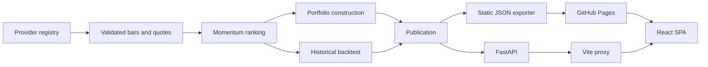

# Technical Documentation

## System overview

US Momentum Terminal has two supported execution modes:

- **Static production:** GitHub Actions builds the Python publication, writes JSON to
  `frontend/public/data/`, and deploys the React app to GitHub Pages.
- **Local/live:** React calls FastAPI through Vite's `/api` proxy while the Python service retrieves
  and caches provider data.

Both modes consume the same publication and stock-detail schemas.



See [DATA_PIPELINE.md](DATA_PIPELINE.md) for scheduling, validation, rollback and browser-cache
details.

## Repository layout

```text
data-service/app/
  providers/       Provider adapters and failover registry
  config.py        Non-secret runtime settings
  cache.py         Atomic JSON cache
  clock.py         NYSE session state and timeliness
  momentum.py      Ranking and momentum metrics
  portfolio.py     Constrained model portfolio
  backtest.py      Historical simulation
  macro.py         CPI-U loading
  snapshot.py      Publication and stock-detail builders
  main.py          FastAPI endpoints
data-service/scripts/
  export_static.py Validated GitHub Pages exporter
data-service/tests/
  test_*.py        Unit and contract tests
  *_probe/*audit   Live diagnostics and reproducible reports

frontend/src/
  api/             Static/live adapter, request dedupe and browser cache
  components/      Shared cards, charts, states, navigation and data dialog
  styles/          Tokens, shared layout and page CSS
  utils/           Formatting, calculations and chart helpers
  *Page.jsx        Five application screens
frontend/public/data/
  publication.json
  manifest.json
  stocks/*.json
```

## Frontend

The app uses a small history-API router. Main pages remain mounted while hidden so Screener filters,
sorting and pagination survive navigation to Stock Analysis. Stock Analysis loads only the selected
stock detail.

`MarketProvider` owns:

- publication state;
- initial browser-cache hydration;
- background update checks;
- last-valid fallback;
- update notices;
- stock-detail loading.

`client.js` selects `live` or `static` mode and deduplicates identical in-flight requests. It never
places provider keys in browser code.

The page shell renders independently of data. `getSectionState` resolves each card or section to
loading, ready, error or empty; existing cached data always wins over a refresh failure. Shared
`DataState`, `ChartState`, KPI skeleton and table-skeleton components preserve the approved card and
table footprints. This avoids page-level loading screens and prevents unrelated sections from being
removed by one request.

The update pill opens a Data & Cache dialog with the actual collection timestamp, market date,
provider, coverage and browser-cache time.

The Screener, Portfolio and Backtesting export controls share one `ExportMenu`. It offers exactly two
formats — `Excel Workbook (.xlsx)` and `CSV (.csv)` — in a compact two-row popover. CSV output includes
the complete selected result set. Excel output is generated client-side as a real `.xlsx` workbook
with formatted numeric columns, filters and frozen headers; spreadsheet dependencies are loaded
lazily only after the user chooses Excel. In the Screener toolbar the trigger is the same `AppButton`
as the Filters control, so both pills share one height, padding, radius, icon size and hover state.

### Universe and dataset state

`UniverseProvider` keeps two values: the universe selected for the next Backtesting run and the active
dataset universe. Overview, Screener and Portfolio resolve `datasetForUniverse(data, activeUniverse)`
and read every value — selected tickers, portfolio, holding count, sector split, Top Momentum,
performance and export rows — from that single dataset. A successful backtest activates its own
universe; choosing a dataset from the Screener toolbar activates it app-wide. Editing the Backtesting
selector alone never relabels completed results.

Temporary state (universe mismatch, outdated results, export outcome, missing history, invalid
settings) is reported through one black notification card in the bottom-right corner. Pages do not
render inline warning banners, and a page-level notification suppresses the data-state toast so only
one card is visible. Errors that block work stay until dismissed and expose Retry.

## Data sources

Yahoo Finance via `yfinance` is the default provider. It supplies daily OHLCV, adjusted closes,
dividends, splits and current quote metadata. Optional adapters are available for Twelve Data and
FMP; Stooq is disabled. Provider evidence is in
[data-service/docs/DATA_PROVIDERS.md](../data-service/docs/DATA_PROVIDERS.md).

The universe is curated: 108 audited core symbols plus 92 sector-balanced mid-cap additions. A
snapshot normally contains 198 eligible stocks after exclusions.

Validation rejects missing common dates, non-USD securities, non-common-stock quote types, prices
below $5, insufficient observations and stocks below the three-month liquidity threshold. Adjusted
closes are never replaced with raw closes.

Two eligibility stages are reported separately, and every exclusion carries its reason:

| Stage | Question | Consequence |
| --- | --- | --- |
| Momentum-eligible | Is there enough clean history to score this name? | Enter the cross-section and receive a Z-score and score |
| Portfolio-investable | Is there a verified, strictly positive float-adjusted market cap? | Eligible to be selected and sized |

A name can be momentum-eligible and still not investable. Such names keep their rank and score on the
Screener, appear in `portfolios.*.excluded_no_market_cap`, and are skipped — never given a substituted
or zero weight. In the current publication 198 names are momentum-eligible and 174 are investable.

## Momentum

```text
12–1 momentum            = P(t−21) / P(t−252) − 1
observation window       = adjusted closes t−252 … t−21   (232 closes, 231 returns)
daily volatility         = sample std-dev (ddof=1) of the 231 daily returns in that window
risk-adjusted momentum   = 12–1 momentum / daily volatility
Z                        = (value − mean) / population std-dev
Z                        = clip(Z, −3, +3)

Score = 1 + Z          if Z > 0
Score = 1 / (1 − Z)    if Z < 0
Score = 1              if Z = 0
```

**Window convention.** In positional Python terms the observation window is `adj[t-252 : t-20]`.
The exclusive end index makes the last observation `t-21`, so the window is exactly the price path the
12–1 numerator and denominator already use. The 21-session skip month is excluded from *both* the
signal and the volatility estimate: a violent recent month can no longer inflate the risk denominator
of a name whose 12–1 momentum deliberately ignores that month.

The ranking needs at least 253 observations. Z-scores are formed once, over the complete eligible
cross-section for the calculation date — never separately for Top 20 and Top 100. The Screener supports
Top 100 and Top 20; both are exact stock counts.

## Portfolio

**Selection and sizing are separate rules.**

1. *Selection.* Portfolio-investable stocks are ranked by Momentum Score, descending, with a
   deterministic tie-break: higher score, then higher risk-adjusted momentum, then ticker alphabetically.
   Top 20 and Top 100 are the first 20 and first 100 entries of that one ranked list, so Top 20 is
   always a prefix of Top 100 for the same dataset. Market capitalisation never reorders this ranking.
2. *Weighting.* The selected names are sized with the official square-root rule:

```text
raw weight = Momentum Score × (float-adjusted market cap / median float-adjusted market cap) ^ 0.5
```

`Beta = 0.5` is the production default and is not user-configurable. The median is a common positive
denominator, so it cancels in normalization; it only keeps the exponent on an interpretable scale. A
capped solver then applies a 9% stock limit and a 35% sector-group limit, redistributing proportionally
inside an over-cap group. If the constraints cannot be satisfied, the portfolio is unavailable with an
explanatory reason and no book is published.

**Why the square root.** Linear (Beta 1.0) weighting lets the largest companies dominate a momentum
book: with the same 100 names and the same ranking, top-10 weight is about 57% under Beta 1.0, about
37% under Beta 0.5 and about 19% under Beta 0.0. Beta 0.5 keeps a positive size preference without
concentrating the book. See `data-service/docs/weighting_comparison.json`.

**Sector scope.** The 35% cap is enforced on *combined sector groups*, not on the eleven individual
GICS-style sectors shown in the donut: Technology, Communication, Healthcare, Industrials are their own
groups; Consumer Discretionary + Consumer Staples form `Consumer`; Financials, Energy, Materials,
Utilities and Real Estate form `Others`. The solver and the published validation read the same
`group_sector()` mapping, so the check can never approve a book under a different classification than
the one that built it. Each holding carries its `sectorGroup`.

The publication contains `portfolios.top100` and `portfolios.top20`. Backtesting's Universe control
is persisted under `umt:universe:v1` and read through one React context shared with Portfolio.
Portfolio does not own a duplicate selector. Its KPIs, holdings, sector allocation, target-holdings
rule and CSV/XLSX export all resolve from the selected published book.

## Backtesting

The backtest supports monthly, quarterly, semiannual and annual schedules. The initial book forms at
the selected start; later signals use the final trading session of each scheduled month and execute
at the next available adjusted close. Selection uses the same score ranking and the same tie-break as
the live book.

Weighting depends on what is genuinely knowable at each signal date:

| Condition | Weighting | Reported as |
| --- | --- | --- |
| A point-in-time float cap covers every selected name | `score × (cap/median)^0.5`, then the 9% / 35% caps | `score-size`, `live_weighting_tested: true` |
| Point-in-time shares outstanding cover every selected name, but historical float shares do not | `score × (shares outstanding × split-normalized price / median)^0.5`, then the same caps | `score-size-proxy`, `live_weighting_tested: false` |
| Float input is incomplete and no point-in-time size history exists | equal weights with the same caps | `equal-weight-proxy`, `live_weighting_tested: false` |

The configured providers do not publish historical float shares. The shipped publication therefore
has 0% point-in-time float coverage. It sizes from point-in-time shares outstanding so the historical
book keeps a genuine, knowable size preference, but labels every event `score-size-proxy` and sets
`live_weighting_tested: false`. Each `holdings_log` entry records its own `weighting_mode`, and
`methodology` records float-sized, outstanding-share-proxy and equal-weight counts separately. Current
float caps are never substituted into a past date.

Universe selection uses exact `top_n` values of 100 and 20. A monthly Top 20 signal can be reported as
infeasible when its 20 highest-ranked names occupy too few solver groups to reach 100% under the 35%
cap; the application reports that reason instead of substituting a different ranking rule.

- Transaction cost: 0.10% of traded notional.
- Slippage: 0.00%.
- Sharpe risk-free rate: 0%.
- Benchmarks: SPY and SPMO, measured over the strategy's own window.
- Total-return path: provider adjusted closes.
- Dividend-cash path: split-normalized closes with dividends retained as cash.

Performance metrics use simple daily returns. Volatility and tracking error are sample standard
deviations annualized by `sqrt(252)`. Sharpe and Sortino retain the documented 0% risk-free-rate
assumption. Beta is covariance divided by benchmark variance; information ratio is mean active return
divided by active-return volatility. The first calendar period is measured from the 100 starting
capital, so the initial entry cost is included rather than silently omitted.

The Backtesting workbook includes Daily Performance, Drawdown, Account Balances, Monthly Returns,
Rebalancing History, Cash Flows, Performance Summary, Benchmark Comparison and Backtest Settings. The
report and the on-screen tables read the same selected window and accounting simulator.

The frontend supports date bounds, initial capital, recurring contributions, contribution frequency,
dividend mode, CPI adjustment, rebalance frequency, chart window, linear/log scale and YTD rows.

## Cash-flow accounts

Cash flows are part of the Python backtest response, not a display-only adjustment. Strategy, SPY and
SPMO each receive the same requested monthly, quarterly or annual schedule. The configured flow is
applied after that session's investment return at the close:

- an inflow buys additional fractional total-return units at the close;
- an outflow first uses any available cash, then redeems fractional units;
- requested withdrawals are capped at account value, with any shortfall recorded as unpaid;
- an account depleted to zero has zero units and cash and cannot recover from market movement alone;
- a later valid inflow buys units and can rebuild the account.

The response includes daily balances, holdings value, cash, units, cumulative TWR, events and the
investor cash-flow ledger for every account. The full-window UI consumes these backend accounts; a
narrower chart range uses the same deterministic unit-account simulator in the browser.

```text
account value = units * NAV + available cash
TWR           = linked NAV return, independent of external flows
MWR / XIRR    = IRR of dated actual investor cash flows
net P&L       = ending balance + actual withdrawals
                - initial capital - total inflows
```

The export contains a day-by-day Account Balances sheet in addition to Cash Flows, so holdings value
plus available cash can be reconciled to each account balance.

CPI-U All Items (`CPIAUCNS`) comes from FRED/BLS. Values are treated as available on the 15th day of
the following month and previous published observations are used rather than interpolation.

## HTTP API

| Method | Path | Purpose |
| --- | --- | --- |
| GET | `/api/health` | Service, cache and provider state |
| GET | `/api/snapshot` | Complete publication |
| GET | `/api/stock/{ticker}` | Stock detail, weekly prices and rank history |
| GET | `/api/bars/{ticker}` | Normalized daily bars |
| POST | `/api/backtest` | Date- and schedule-bounded backtest |
| GET | `/api/providers` | Provider configuration |
| GET | `/api/probe` | Last provider probe |
| GET | `/api/config` | Non-secret runtime config |
| POST | `/api/provider` | Select and verify a provider |
| POST | `/api/refresh` | Forced background refresh |

Live responses that must show current freshness use `Cache-Control: no-store`.

`POST /api/backtest` accepts `initial_capital`, `cashflow_enabled`, `cashflow_amount`,
`cashflow_frequency` (`monthly`, `quarterly`, `annually`) and `cashflow_direction` (`inflow`,
`outflow`) in addition to portfolio, dates and rebalance frequency. Invalid or non-finite capital,
amounts, frequencies and directions return HTTP 400. The response includes `cashflowAccounts` for all
three accounts.

## Configuration

Important environment variables:

| Variable | Default |
| --- | --- |
| `VITE_DATA_MODE` | `live` in dev, `static` in production |
| `VITE_API_BASE_URL` | `/api` |
| `VITE_BASE_PATH` | `/` |
| `DATA_PROVIDER_CHAIN` | `yahoo,twelvedata,fmp` |
| `DATA_HISTORY_YEARS` | `10` |
| `DATA_TTL_SNAPSHOT` | `900` seconds |
| `DATA_TTL_BARS_INTRADAY` | `900` seconds |
| `DATA_TTL_BARS_CLOSED` | `21600` seconds |
| `DATA_TTL_META` | `86400` seconds |
| `DATA_CACHE_DIR` | `data-service/cache` |

Static deployments load the selected backtest schedule from `public/data/backtests/`; local/live
mode uses `POST /api/backtest`. Provider keys are optional. `.env` is ignored; only `.env.example`
is tracked.

## Testing and audits

```bash
npm run data:test
npm run data:build-static      # add --write-seed to refresh the API seed too
npm run data:validate-static
npm run data:weighting         # Beta 0 / 0.5 / 1 comparison + point-in-time audit
npm run test:frontend
npm run test:sites
npm run build
```

`npm run data:probe` records live provider availability but is not part of CI because it depends on
third-party network access. `npm run data:weighting` writes
`data-service/docs/weighting_comparison.json`: it re-sizes the current cross-section under Beta 0 /
0.5 / 1 with the selection held fixed, audits point-in-time float coverage, and reports the historical
comparison as unavailable when that coverage is zero rather than fabricating one.

## Limitations

- Yahoo Finance is unofficial and provides no SLA.
- The universe is curated, not a complete securities master.
- Current constituents introduce survivorship bias.
- No historical float shares or sector history is available, so point-in-time float-adjusted market
  cap coverage is 0%.
- Historical shares outstanding are available and drive a point-in-time `score-size-proxy`. The Beta
  0.5 float-cap sizing rule is therefore **not** historically validated; `methodology.weighting_mode`
  and `live_weighting_tested` state that limitation explicitly.
- Delisting returns, taxes, market impact and capacity constraints are not modelled.
- The static production site updates after collection/deployment and is not a real-time trading feed.
- Provider terms and redistribution permissions must be reviewed before commercial use.
